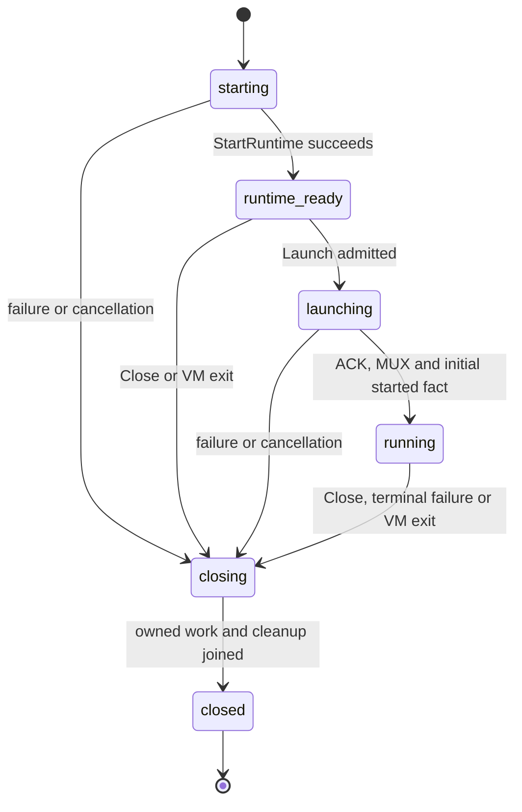

[English](runtime.md) | [简体中文](runtime_zh.md)

# Runtime: start, control, capture and restore

`pkg/runtime` is the public Go entry point for owning one MicroVM; `sandbox-ctl`
adapts the same operations to a host CLI. This page follows that object's life:
prepare inputs, create a base runtime, launch a workload, execute or capture it,
and close it. It owns operation/state preconditions and coordination across the
guest, VMM, memory, disks and resource controller.

For a first standalone run, build the binaries as described in the
[README](../README.md#build-and-test), prepare the kernel, runtime Bundle and a
flattened workload image, and render a [configuration](configuration.md#render-config).
Use the [run examples](#run) to choose explicit cold start, cold start from E, or
restore from S. Follow [capture](#snapshot) with a new SandboxID to reuse a
snapshot as an independent instance. There is no separate live-fork CLI or SDK;
`snapshot --resume` and `run --restore` express that workflow.

| Task or boundary | Read here |
| --- | --- |
| Embed `StartRuntime`, `Launch`, `Start`, `Restore` and ownership | [Runtime SDK](#runtime-sdk) |
| Run, execute, snapshot, live export | [Run](#run), [exec](#exec), [snapshot](#snapshot), [export](#export) |
| Cross-resource capture and host control socket | [Capture barrier](#capture-barrier), [control protocol](#control-protocol) |
| Offline assembly, reset, inspection and publication | [Artifacts](artifacts.md) |
| Disk checkpoint list/delete/GC and `Disk` APIs | [Block storage](block-storage.md#checkpoints) |
| Usage commands and resource accounting | [Resources](resources.md#usage-cli) |

This guide describes the current source revision. A selected platform release
may pin different component versions; use its included guides and matching
artifacts. The current reader rejects the old `snapshot.cfg` disk-graph schema;
there is no dual reader, automatic migration or arbitrary cross-version restore
guarantee. See [artifact compatibility](artifacts.md#compatibility).

<a id="standalone-workflow"></a>

## Complete standalone workflow

Prepare an absolute local kernel path, a matching runtime Bundle, and a flattened
EROFS workload image with a mountable ext4 upper source. A preformatted template,
existing diff or immutable upper is required; `run` does not format a blank file.
The following sequence assumes those inputs are bound in `sandbox.yaml` and the
chosen workload remains alive. Local operations need the Linux/KVM privileges
listed in the [build and runtime prerequisites](../README.md#build-and-test).

1. Create and edit the complete commented template, then validate it:

   ```bash
   sandbox-ctl config --template -o sandbox.yaml
   # Set the kernel, runtime, image, ext4 source and workload for this host.
   sandbox-ctl config --config sandbox.yaml --check strict
   ```

2. Start the runtime in one terminal:

   ```bash
   sandbox-ctl run --config sandbox.yaml --sandbox-id demo-1
   ```

3. In another terminal, use a command that exists in the workload, then capture
   a reusable snapshot while continuing the original runtime:

   ```bash
   sandbox-ctl exec --sandbox-id demo-1 -- /bin/sh -c 'printf "guest ready\n"'
   sandbox-ctl snapshot --path-id demo-1 --output ./artifacts --resume
   ```

4. Project host-only restore configuration and create an independent instance:

   ```bash
   sandbox-ctl config --config sandbox.yaml --mode restore -o restore-host.yaml
   sandbox-ctl config --config restore-host.yaml --mode restore --check strict
   sandbox-ctl run --restore ./artifacts/demo-1.snapshot \
     --config restore-host.yaml --sandbox-id demo-2
   ```

The snapshot command reports its committed root; use that returned reference if
output mode or location differs from this local example. Review current-instance
network identity and writable paths before reusing host configuration for another
SandboxID. Closing either runtime releases that runtime's ownership; destroying
a runtime does not authorize deleting shared immutable artifact dependencies.
Use [live export](#export) when the desired result is a cold-start E without
memory state, or [offline assembly](artifacts.md#assemble) to build E without a VM.

<a id="runtime-states"></a>

## Runtime states and operation lifetime

[`Runtime.State`](../pkg/sandbox/runtime_sdk.go) exposes the following names.
These are the runtime owner's states, distinct from Guest launch facts and node
resource-protocol states.



Pure Launch validation can return an error while retaining `runtime_ready` for a
corrected input. Once launching starts, failure is terminal. `Stats` can observe
the ready base; `Exec`, `Snapshot` and `Export` need a running workload. `Restore`
reconstructs an existing application directly and returns the same public owner
type; it does not invoke a new cold Launch. `Wait(ctx)` only waits, while `Close`
requests shutdown and joins the retained exit result. The detailed source,
context, descriptor and callback ownership contract follows below.

<a id="operations"></a>

## Operation map

Read commands with the state or capability they operate on:

| Command | Reference |
| --- | --- |
| `run` | [runtime](runtime.md#run) |
| `exec` | [runtime](runtime.md#exec) |
| `snapshot` | [runtime](runtime.md#snapshot) |
| `export (live)` | [runtime](runtime.md#export) |
| `export --from` | [artifacts](artifacts.md#assemble) |
| `reset` | [artifacts](artifacts.md#offline-reset) |
| `checkpoint list/delete/gc` | [block-storage](block-storage.md#checkpoints) |
| `usage` | [resources](resources.md#usage-cli) |
| `config` | [configuration](configuration.md#render-config) |
| `info` | [artifacts](artifacts.md#inspect) |
| `publish / upload-snapshot` | [artifacts](artifacts.md#publish) |

`upload-snapshot` is a compatibility alias for `publish`. Restore uses `run --restore`; there are no standalone `restore`, `pause`, `resume` or `stats` subcommands.

<a id="runtime-sdk"></a>

## Runtime SDK and explicit cold start

The first-class Go API is [`pkg/runtime`](../pkg/runtime/runtime.go):

```go
StartRuntime(ctx, RuntimeSpec) (*Runtime, error)
(*Runtime).Launch(ctx, LaunchSpec) error
Start(ctx, SandboxSpec) (*Runtime, error)
Restore(ctx, RestoreSpec) (*Runtime, error)
```

`Start` uses `StartRuntime` followed by `Launch` and closes its internal owner if
launch fails. `Restore` reconstructs snapshot memory, CPU/device state and the
workload directly, returning the same live owner after the existing restore ACK
and MUX barrier. It never cold-boots first or requires `runtime_ready` from an
older snapshot. The CLI converts its existing config/`--from` inputs into this
SDK; cross-process administrative commands retain the local control transport.

For cold starts from a Sandbox artifact, use
[`sandbox.OpenRunSource`](../pkg/sandbox/run_source.go)(ctx, ref, storage, locations)
and `source.Apply(host, presence, config.ApplyFromOptions{...})`. Apply returns
the effective configuration and a `LaunchSpec` with a portable source baseline,
checkpoint provenance and paired Bundle selectors. It shares the CLI's source resolution,
default boot binding and presence-aware override rules without modifying host
configuration or binding the disk graph twice. Keep the source and its borrowed
storage open until `Wait` reports the runtime's exit result or `Close` completes; canceling `Wait` does
not end this borrowing. With `ReplaceBoot`,
the result keeps no source provenance or scoped selectors, so the source may be
closed immediately after Apply; the returned storage remains borrowed. These
helpers neither start a VM nor acquire checkpoint writers. Set runtime host
options, stdio and forwards separately before starting.

Pass that complete `LaunchSpec` to
`sandbox.DeriveRuntimeSpecWithOptions(ctx, cfg, sandbox.DeriveRuntimeOptions{Launch: launch, ...})`,
then use the returned shape and the same launch value with `Start`, or with
`StartRuntime` followed by `Launch`. Derivation reads disk capacities and freezes
the opened source identity, input portable boot refs and selected host boot paths;
it does not open host kernel/runtime files. `StartRuntime` resolves the target
components, and `Launch` derives a new C0 with their identities while preserving
the source workload and disk graph. Changing source provenance or input boot refs
after Apply, or host boot paths after derivation, is rejected. Copying the returned
value preserves this binding; reconstructing public fields with
`LaunchSpecFromConfig` does not. An intact Apply result can also launch on a base
Runtime whose shape was not derived from that source. A hand-written
`PortableConfig` or `SourceBinding` without the Apply receipt still requires
matching host identities. `ReplaceBoot` uses a complete explicit cold boot graph
and derives C0 from it. The retained source record owns no additional readers,
storage or checkpoint pins.

`RuntimeSpec` contains kernel/Bundle bindings, CPU/memory and resource policy,
host TAP/provider/namespace requirements, console/control settings and ordered
`RuntimeDiskSpec` entries. Each logical disk fixes its name, single/overlay
layout and logical capacities. Overlay expands to a read-only base followed by
a writable upper; single expands to one writable device. The existing minimal
virtio feature profile is fixed for all devices. No device hotplug is involved.

Cold startup first looks for kernel identity in exactly `<configured-kernel-path>.sha256`.
The sidecar is an optional readable regular file of at most 4 KiB. It contains
one 64-digit hexadecimal SHA-256 digest, or one untagged sha256sum record with
the exact configured kernel basename (`<digest>  vmlinux` or
`<digest> *vmlinux`). LF/CRLF and one final newline are accepted; extra records,
fields, paths, and malformed content fail startup. A present invalid, unreadable,
nonregular, or dangling sidecar is an error. When absent, every cold startup hashes
the raw target kernel once, including `run --from` and the source-derived SDK
path. The resulting target kernel identity is recorded in the new run's C0;
E's old kernel identity does not constrain a cold boot.
For a prepared inactive deployment version, generate the sidecar from
the final **raw** kernel, for example `sha256sum -- vmlinux > vmlinux.sha256`,
and install the pair consistently. The sidecar is trusted deployment metadata:
Sandboxer does not recompute its digest from bytes CH loads. The runtime Bundle
identity still comes from its footer. Keep version-specific kernel and sidecar
bindings stable through identity resolution and CH startup; switching a `current`
symlink alone cannot pin all pathname lookups of an in-flight startup. Use a
stable version path or coordinate the switch. No sidecar is generated or cached
by startup. Memory restore keeps the original C0 and neither opens the external
kernel nor reads its sidecar.

`LaunchSpec` owns workload root/data artifact references and writable paths,
guest IP/MTU/routes/hostname/interface, mounts, persistent and ephemeral files,
init actions, complete process configuration (including plugins, user, restart,
PID namespace and cgroup delegation), stdio, forwards and artifact access.
`LaunchSpecFromConfig` preserves the complete configuration ABI.
`Credentials` uses `ArtifactCredentials{Config, CustomerKey}` to create owned
storage without consulting or changing environment variables. Alternatively,
`Storage`, `Fetcher` and Bundle selectors are borrowed and must remain open and
unchanged until `Wait` returns the exit result or `Close` completes; canceling a
single `Wait` does not end the borrowing. SDK-created readers, storage and automatic diffs
are released by the runtime. Caller-specified diff/template paths are not
deleted; inherited cgroup and forwarding descriptors are borrowed or duplicated.
Kernel/Bundle paths and artifact inputs must remain readable and immutable for
their borrowed lifetime. TAP handoff descriptors received by the SDK are runtime-owned. A forwarding
socket path must be unused; binding fails rather than removing an existing path.

Base startup establishes unbound devices before CH boots. Their metadata is
available, but data requests promptly complete IOERR. An unbound request never
fabricates zeros, retries indefinitely or becomes a runtime-fatal storage error.
Launch prepares and validates every backend before one atomic binding-set
publication. Each segmented virtio request pins one binding view. Only after
publication does the guest assemble the workload root and switch root. COW
writeback fatal hooks, context-aware I/O, statistics and snapshot views continue
through the bound backends.

`Launch` accepts only one workload. Pure input/state validation may reject
without consuming the opportunity. Once `launching` begins, failure or
cancellation terminates the runtime; another workload cannot replace it. The
token-bound initial started fact, after the ACK/MUX barriers, commits launch
success against Close,
cancellation and CH exit. This retains existing startup readiness: it does not
prove target execve success or application health. Waiting for assignment after
`runtime_ready` is outside the launch execution timeout. Base runtimes retain
resource reservations, controller heartbeat and resource stats, but do not
report workload ready or Settled before launch.

The SDK cold-launch path waits for `launch_ack` under `launch.start_timeout`
and the operation context. Post-ACK `timeouts.app_start` is an optional overall
deadline: omitted/empty/`0` adds none; positive opts into a bound; negative/invalid
is a configuration error. Only positive values create a timer.
`DefaultAppStartDeadline` remains a deprecated zero constant and must not be
passed unconditionally to NewTimer. Socket `timeouts.app_notify` and other phase
policies retain their own semantics.

Host supplies a unique initial Launch token. Guest records pending, started,
failed or exited at the actual startup/termination boundary. The fast app_started
notification and existing Pinger's verified Pong publish the same fact to one
confirmation entry. PID presence, reachability and restore's fixed running field
are insufficient. Success requires ACK and MUX; failed/terminal facts also end
pre-ACK waiting. Old tokens are ignored, invalid states fail, and late started
cannot overwrite a terminal error.

Commit checks owner/operation cancellation, Runtime state, permanent read errors
and the current fact under the existing readiness/Runtime lock order. It signals
internal completion before the user callback. Blocked callbacks cannot strand
Launch, Pinger Pause/Stop or management-connection join. Pinger only publishes a
bounded fact; callbacks run outside its tick and after notification connection
close. Success and timeout/cancel/exit retain one linearized result.

New Launch requires `initial_launch_state_v1` in runtime-ready hello before
LaunchSpec/apply. Build sandbox-init and runtime Bundle together, including any
prewarmed Guest intended for a new Launch. Missing capability fails explicitly
without a two-second fallback. Old Hosts ignore additive Guest fields. Ordinary
restore of an existing application retains restore/attach semantics and does not
consume an old token for a new Launch. Host upgrade cannot replace init inside
an existing snapshot. Primary restart retains the completed initial fact and
existing supervision/notifications.

The supported prewarm boundary is a live `runtime_ready` instance followed by
Launch. The current SDK rejects Snapshot/Export before running, and a Guest
without a workload rejects restore/attach/quiesce. Persisted prewarm-memory
restore followed by a new Launch is not an implemented API. If such a state is
provided by another lifecycle, the new Launch still requires the compatible
Guest capability; this does not make an old snapshot's init upgradeable.

Default PingFatalThreshold remains zero. Indefinite recovery can retain resources
until cancellation/Close, permanent failure or real VM exit. Positive AppStart or
explicit PingFatal selects bounded termination and cannot simultaneously promise
unlimited recovery. Portable artifacts exclude host policy; Builder retains its
outer work deadline.

Operation contexts bound startup, launch, restore, live operations and individual
waits. Canceling a successfully completed startup/launch context cannot kill the
returned runtime or invalidate later lazy reads. `Wait(ctx)` cancellation only
cancels that wait. Repeated waits observe one retained `ExitResult` after cleanup;
concurrent, idempotent `Close` requests graceful VMM shutdown through one owner,
keeping backends alive until CH exits and joining owned work before releasing
storage. The SDK installs no OS signal handlers. The CLI registers SIGTERM and
SIGINT and retains second-signal escalation. It also supplies SIGWINCH through
`stdio.Mode.WindowChanges`; the SDK consumes that channel without registering
signals. Cleanup cancels and joins idle input pumps without closing inherited
stdin. An input descriptor has one consumer while bridged.

Live `Exec`, `Snapshot`, `Export` and `Stats` call the owner directly. Exec returns
a caller-owned guest MUX connection and its negotiated stdio spec. Capture uses
the existing `ctl.Request` options and E/S output schema without CLI serialization.
Exec and capture require a running workload; resource stats also work in the
base state. No scheduling, placement or runtime pool policy is included.

The normal CLI adapter preflights known workload inputs before starting the base
runtime. A caller using the split API supplies them later:

```text
StartRuntime: validate shape and boot bindings; retain host identity facts and source ancestry
  -> reserve resources and acquire host network
  -> create memfd/UFFD, fixed unbound vhost devices and control servers
  -> spawn CH -> guest base initialization -> runtime_ready
Launch: resolve workload inputs and form complete immutable portable C0/provenance from retained host identity
  -> prepare all storage -> validate all devices -> publish bindings
  -> send launch -> assemble workload root -> switch root/configure
  -> launch_ack/MUX -> app_started/ready
Close or exit: reap CH -> drain owned services/work -> close retained resources
```

Predictable config/ref/format failures in the CLI preflight still fail before VM
side effects. Split launch necessarily resolves workload artifacts after the base
VM exists. C0 is written once when complete launch inputs are known, before the
guest consumes the workload, and remains unchanged. Launch never repeats kernel,
sidecar, or Bundle identity lookup after `runtime_ready`, even if their pathnames
change. A new Runtime resolves its own identity. For a source-derived shape,
`Start` validates the matching source/C0 before creating the VM; split `Launch`
validates the same binding before checkpoint materialization can legitimately
replace the disk graph and provenance. Rejected source inputs leave a ready base
available for a corrected `Launch`. Source cold derives C0 with the target
kernel/runtime identities and retains the effective source disk graph and
provenance. A hand-written `PortableConfig` without the Apply receipt remains
strict: its kernel ref must match the retained host kernel ref, and its runtime
must match the retained digest scheme and digest. The runtime basename is only a
lookup hint. Local `PortableConfig` without `SourceBinding` remains supported.
The CLI's explicit cold `run`, `--from`, and `--replace-boot` reuse their preflight
identity through `Start`, avoiding a second scan. Memory restore preserves the
original C0 and needs no external kernel file, sidecar, or cold-start projection.
This retained-identity rule does not permit rewriting the live runtime Bundle
pmem backing contents; its existing lifetime requirements still apply.

<a id="run"></a>

## `sandbox-ctl run`

The runtime owns `<RunRoot>/<PathID>/<SandboxID>.pid` and its process-associated POSIX lock. Cold, `--from` and restore paths acquire this identity before publishing runtime files or admitting resources; a competing launch must fail without truncating the owner PID file or deleting its RunDir. Directory cleanup completes while the identity is still held. This is execution identity, not a second resource reservation. The same-PID exec launcher remains supported; a resident task parent must not own the runtime PID file.

The three input modes are strictly separate:

```bash
# Explicit cold start.
sandbox-ctl run --config sandbox.yaml --sandbox-id s1

# Cold start from Sandbox E.
sandbox-ctl run --from ./s1.sandbox --config host.yaml --sandbox-id s2

# Cold derivation from Sandbox E defaults with a completely new boot graph.
sandbox-ctl run --from ./s1.sandbox --replace-boot \
  --config replacement.yaml --sandbox-id s2-rebased

# Resume memory execution state from Snapshot S.
sandbox-ctl run --restore ./s1.snapshot --config restore-host.yaml --sandbox-id s3
```

RunRoot/BaseRoot are invocation-level roots; RunDir/BaseDir are the actual directories for this Sandbox. `SandboxID` always denotes logical identity. `PathID` is only the directory leaf shared under the two roots:

```text
pathID  = explicitly supplied PathID, otherwise SandboxID
RunDir  = RunRoot/pathID
BaseDir = BaseRoot/pathID
```

For example, a Build phase can retain a globally unique SandboxID while using a fixed private directory:

```bash
sandbox-ctl run \
  --config phase-a.yaml \
  --sandbox-id build-01-phase-a \
  --path-id a \
  --run-root /run/sandbox/builds/build-01 \
  --base-root /var/lib/sandbox/builds/build-01
```

PathID must be a nonempty, safe, single path component: neither `.` nor `..`, and containing no `/`, backslash, or NUL. It is not compared with SandboxID, and there is no PathID-to-SandboxID mapping. Default writable diffs for root/data disks reside in the PathID-derived BaseDir, but their filenames still use logical SandboxID, for example `BaseRoot/a/build-01-phase-a.overlay.diff` and `BaseRoot/a/build-01-phase-a.disk0.diff`. Cold, `--from`, and `--restore` modes use the same rule. Normal Sandbox exit cleans up only the current PathID's RunDir and owned diffs; it does not recursively remove the supplied RunRoot/BaseRoot or sibling PathIDs.

`--from` and `--restore` are mutually exclusive. Ownership of `--config` differs by mode:

- Ordinary run: a complete explicit cold configuration.
- `--from`: a host/instance overlay; E supplies the portable workload.
- `--from --replace-boot`: E supplies only non-boot portable defaults; the host configuration must supply the complete boot definition.
- `--restore`: host-only restore bindings/policy; S and its referenced E supply execution state and the portable workload.

`--config a.yaml:b.yaml` still merges files in order. `SANDBOX_CONFIG` can replace `--config`. `LoadConfigBytesWithPresence` supplies the same presence-aware rules for in-memory inputs such as config-socket.

`--from` and `--restore` support:

- Raw absolute or relative local paths.
- Scheme-qualified local tarstreams.
- `manifest://<key>`.
- `file://<bundle>@manifest:<key>`.
- Inference of a Bundle's default root key.
- Named `--ref-location name=file:///absolute/path` bindings.

Run's stdio, TTY, console, `--ready-fd`, connect forwarding, and resource parameters retain the same host control semantics in all three modes. Memory restore does not resend the cold launch specification.

<a id="restore"></a>

## Memory restore data flow

`run --restore S` handles only genuine memory Snapshots:

```text
T0 parse host config with presence
T1 open carrier and strict-parse S
T2 parse canonical snapshot.cfg
T3 open S.sandbox_ref and strict-parse E
T4 apply restore host-only rules to E config -> immutable lifecycle C0
T5 select a matching runtime binding and check disk sources
T6 atomically write run-dir C0
T7 bind self and reconstruct root/data disks from E
T8 create memfd and layer S.memory over S.from_refs
T9 create UFFD/va_report endpoints and CH restore argv
T10 start CH from config.json/state.json
T11 transfer UFFD descriptor(s) and complete restore handshake
T12 poll GET /vm.info until the restored VM is Paused
T13 /vm.resume
T14 establish restore MUX and resume original process
T15 settle balloon/resource observation
T16 start pinger, forwarder, sensor, and steady lifecycle
```

Cloud Hypervisor v51.1 binds its API socket before its CLI submits `VmRestore`,
so socket connectivity is not restore readiness. The `vm.info` Paused check is
the correctness barrier before the existing external `/vm.resume`; only the
version's structured VM-not-created response and a not-yet-listening socket are
pending conditions. `timeouts.api_ready` bounds that entire barrier, including
a connected but stalled response. `timeouts.ch_api` independently bounds the
subsequent resume response, and `timeouts.restore` bounds the guest restore ACK
and MUX establishment. This completes the restore-readiness correctness part of
#72; eliminating the resume round trip remains a future optimization and would
require a compatible Cloud Hypervisor version.

Restore does not:

- Read a disk graph from `snapshot.cfg`.
- Cold-start on zero memory.
- Rerun init/files/launch/plugin.
- Treat E's `config.json` as a new process-launch request.
- Update memory parents or C0 as a re-snapshot side effect.

Allowed host-only fields include the network provider/current identity, cgroup/controller, allocatable CPU/memory and resource enforcement, the actual runtime path, active diff/template, restore prefetch, and timeouts. A legacy `boot.kernel` field is accepted but ignored: the running kernel is already captured in S, so no external kernel file or sidecar is required. E's original C0 retains its kernel/runtime identities, immutable disk graph, capacity identity, `deflate_on_oom`, and network topology. See [PortableSandboxConfig](artifacts.md#portable-config).

The memory-restore preflight is also exposed as
[`restore.ResolveRuntimeBinding`](../pkg/restore/runtime.go). First inspect the
supplied `boot.runtime` file using the existing bundle-envelope checks and compare
its **digest scheme + declared footer digest** with E. The basename is a lookup
hint, so the same declared identity under a different name succeeds immediately
without a second lookup. If that file is missing, unreadable, malformed or mismatched, try
exactly one sibling: E's validated runtime basename in the supplied path's parent
directory. The directory is not selected from the default file's symlink target
or Snapshot S's location. No directory scan, download, or identical-candidate
retry is performed. Both candidates use the same check; if neither passes, retain
the encountered causes. Only when every candidate is absent or has a different
content identity does the error match `restore.ErrRuntimeIncompatible`; format,
I/O, and cancellation failures retain their own errors. Invalid ref configuration,
cancellation, and later disk/network/VM errors do not trigger runtime fallback.
The existing local-E-relative default applies when no runtime binding is supplied.
This two-candidate rule belongs to memory restore; cold startup uses its selected
host boot bindings.

Whichever candidate passes, use its absolute local path both for this invocation's
runtime binding and `pmem[0].file` in the generated `snap-state/config.json`. The
captured pmem must be the existing single runtime device with a nonempty file
field. Only that file field changes; device ID, optional size and other attributes,
`state.json`, original S/E and node defaults remain unchanged. The old absolute
path need not exist. For sibling fallback, versioned runtime files must remain immutable and available
under distinct names in the same directory. An explicit matching old-file binding
can instead use a separate version directory; see the [v1/v2 upgrade example](https://github.com/kuasar-sandbox/guest-runtime/blob/main/docs/using-guest-runtime.md#node-upgrades). No full EROFS rehash or runtime copy
is added to restore. The existing `snapshot.restore.sh` verifies that the configured
runtime is selected with the same identity under a different basename, even after
the WORK-owned captured runtime and kernel files are removed and no sibling
fallback exists. It also checks the selected pmem path, unchanged source artifacts
and host inputs, guest readiness and continued execution. Resolver unit tests
cover sibling fallback with a different primary identity.

After restoring S0:

```text
C0 = E0 portable config
memory parent = S0

next snapshot:
  E1 = Export(C0,current disks)
  S1 = memory self + from_refs=[S0,...] + sandbox_ref=E1
```

After an explicit cold start or cold start from E, the memory-parent list is empty. `snapshot --resume` does not silently make S1 the current parent.

<a id="exec"></a>

## `sandbox-ctl exec`

```bash
sandbox-ctl exec --path-id a --run-root /run/sandbox/builds/build-01 -- /bin/sh -c 'id'
```

Local exec may use only `--path-id`. Supplying both `--sandbox-id build-01-phase-a --path-id a` still dials only `RunRoot/a/ctl.sock`; the request gains neither a SandboxID nor a consistency check. Without PathID it continues to use `RunRoot/SandboxID/ctl.sock`.

Exec creates a sibling process through the current ctl/MUX. The export/snapshot quiesce gate atomically prevents new exec/forward sessions from entering the unstable window, and closes and joins already admitted sessions. In-flight execs are terminated and do not automatically rerun after `--resume`. Restore/attach first thaws the application cgroup and reopens exec, forwarding, plugins, and app restart, then sends ACK. The host can publish readiness after ACK and its MUX setup without exposing a still-quiescing exec gate. Guest memory reports resume only after ACK and guest MUX setup. Failed thaw sends no ACK; failed ACK does not undo an already completed thaw, and the existing host recovery/terminal-cleanup path remains responsible. Guest `attach` is an idempotent recovery operation. The host immediately retries once when the request/ACK boundary is ambiguous; lifecycle-context cancellation controls the entire dial/ACK sequence.

Remote authorized exec uses `pkg/ctl.ServeExecTunnel(ctx, options)` in this fixed order:

```text
Authorize -> AcceptDownstream -> ReadExecRequestFrame -> AuthorizeRequest
          -> DialBackend -> write frame.Raw once -> duplex relay
```

Before request admission succeeds, the caller must not dial the backend or trigger Sandbox lifecycle changes. The first frame's JSON payload is limited to 64 KiB, plus its four-byte length prefix. It must contain one `exec_request` with strict field sets, no duplicate fields, and a nonempty `exec.argv` array. Reading waits at most 10 seconds; callers may only shorten that limit. After admission, the original frame is written exactly once without decode/re-encode. Recognized request/backend rejections expose only the sanitized `exec request rejected`; `ProxyExec` remains available only for callers with an already connected backend.

<a id="snapshot"></a>

## `sandbox-ctl snapshot`

The following is ordinary disk-copy capture syntax, without `--checkpoint`; choose one output alternative and omit the square-bracket notation when executing:

```text
sandbox-ctl snapshot \
  --path-id a \
  --run-root /run/sandbox/builds/build-01 \
  (--output /artifacts | --upload) \
  [--mode local|bundle] \
  [--resume] \
  [--drop-caches=false] \
  [--merge-ref=true]
```

For named local capture with `--checkpoint ID`, output defaults to the running owner’s checkpoint directory; an explicit `--output` must select that same directory. See [checkpoint prerequisites and commands](block-storage.md#checkpoints).

A Snapshot always contains memory execution state. One operation produces E and S at the same freeze point, committing S last. On success, the default is to destroy the VM. `--resume` resumes the original VM without making the new E/S its live baseline.

Human-readable local output lists both `Snapshot S` and `Sandbox E`. Default upload stdout still contains only the S Manifest key for shell compatibility. `snapshot_done` returns both `snapshot_ref` and `sandbox_ref`; existing `memory_size`, `memory_resident`, pause/dump timing, and compatibility `overlay_*` response fields remain. `overlay_*` currently mirrors E's identity; only E contains the actual disk graph. The legacy field name `memory_resident` counts explicit logical memory coverage (Data plus Zero), including released pages retained as Zero; it is neither physical residency nor encoded payload size.

`snapshot --json` emits exactly `{snapshotRef,sandboxRef,removedRefs}` and
`export --json` emits exactly `{sandboxRef,removedRefs}`, with `removedRefs:[]`
for capture. These identities come from the completed runtime response (or the
assembly producer for `export --from`). The CLI does not reopen S or infer E
from a filename. A single-root Bundle binds both selectors to the actual final
Bundle file; upload returns both actual Manifest identities for Snapshot. Local
refs expose only basenames and preserve `@digest`, `@hmac`, `@manifest` and any
location. The output directory stays in the caller's execution context. Invalid
or incomplete responses produce an error and no successful JSON. `--resume`
uses the same identity contract; existing default human output and upload-key
stdout remain available without `--json`.

For paired RFC-142 deployment, upgrade sandboxer together with orchestrator.
Operators must clear the old orchestrator local database before upgrading and
recreate records; neither component migrates/backfills it or automatically
removes user data. Old migration tokens missing the required `resumeSandboxRef` field, including
Snapshot tokens without E, must be discarded and reissued from complete S/E records. Portable Export uses that recorded pair even
when artifacts are unavailable; it never reads S to discover E.


`--drop-caches` belongs only to memory snapshot and defaults to false. `--merge-ref=false` captures the complete current working set plus necessary explicit Zero and retains eligible local history in a separate compacted layer H. The default `true` merges cumulative changes with that eligible history. Both stop at the current checkpoint ownership boundary; neither discards required historical memory. Disk compaction is independent. See [checkpoint memory changes](memory.md#checkpoint-changes) and [checkpoint history](artifacts.md#checkpoint-history).

A local `snapshot` needs either `--sandbox-id` or `--path-id`. When both are supplied, PathID only selects `RunRoot/PathID/ctl.sock`; no identity consistency check is performed. `--output` may reside on the BaseRoot filesystem, for example `BuildBaseDir/checkpoint`. The running process cleans its own RunDir/owned diffs and does not treat output as a runtime directory to delete.

<a id="export"></a>

## `sandbox-ctl export`

Live export produces a cold-start Sandbox E from a running workload. Ordinary disk-copy capture uses:

```text
sandbox-ctl export \
  --path-id a \
  --run-root /run/sandbox/builds/build-01 \
  (--output /artifacts | --upload) \
  [--mode local|bundle] \
  [--resume]
```

Named local capture instead uses `--checkpoint ID` with the owner-derived output rules and prerequisites in [Local disk Checkpoints](block-storage.md#checkpoints); it cannot combine with `--upload` or `--from`.

Live mode rejects `--config` and reuses the running process's validated
Manifest/ref-location/crypto bindings. Explicit `--manifest-config` and
`--ref-location` belong to [offline assembly](artifacts.md#assemble).
`--timeout` bounds the client's ctl-socket wait; zero disables that CLI limit.
It does not add a server-side deadline. Export accepts neither `drop_caches`
nor memory-merge parameters, does not call CH `/vm.snapshot`, does not read
the memfd and produces no memory refs.

Like local snapshot, live export may use PathID alone. If SandboxID and PathID
are both supplied, PathID only locates the ctl socket. Default success destroys
the runtime; `--resume` follows the common capture recovery sequence. For an
image-to-E operation without a VM, follow the separate assembly workflow.

<a id="capture-barrier"></a>

## Freeze sequence and failure recovery

Predictable preflight work completes before guest freeze:

```text
T0 output/Manifest/local-crypto/ref/Bundle/merge/config/source preflight
   Close usage admission and break Gauge continuity before the resource barrier.
T1 enter MemoryController/Budget mutation barrier
T2 lock and lift/drain memory.high
T3 pause pinger and gate new host exec/forward; guest drains exec/forward and
   mem_report, freezes app, syncs, closes MUX; after quiesced+EOF the host
   joins residual exec/forward handlers
T4 pause CH, quiesce all block backends
T5 capture every data disk exactly once
T6 build C1 from immutable C0 + source binding + captured disk refs
T7 capture root once and emit Sandbox E
```

Export continues:

```text
T8 commit E last
T9 destroy, or --resume backend -> CH -> MUX/pinger/forward -> app -> barrier
```

Snapshot continues within the same T4 freeze:

```text
T8  CH /vm.snapshot -> config.json/state.json
T9  scan/capture memory self
T10 build S(snapshot.cfg.sandbox_ref=E, from_refs=memory parents)
T11 commit S last
T12 destroy, or --resume full recovery
```

Export never drops caches, invokes `/vm.snapshot`, or reads CH snapshot files or memfd. Snapshot reads disks once, rather than capturing them once for E and a second time through an old disk path.

Disk SnapshotView is stable only while the backend is quiesced. V1 keeps the VM paused throughout sink reads; the VM cannot resume while the sink continues reading that view.

Failure semantics:

- Data artifacts/E can remain as content-addressed orphans. Reclamation belongs to the owning storage/retention policy; sandboxer does not promise automatic graph-aware collection of local output or a shared location.
- The root alias is committed only after E or S succeeds.
- `--resume` recovery after success or failure follows backend → CH → MUX → pinger/forward → app → resource barrier.
- With an ambiguous attach ACK, the host retries the idempotent operation once. If it still cannot establish MUX, capture becomes a terminal failure. While retaining memory/`memory.high` guards, the host requests VMM shutdown and uses bounded SIGTERM/SIGKILL fallback. It does not leave a VM that accepts new requests while the guest remains frozen.
- Default destruction also waits for CH exit. Failed or timed-out `/vmm.shutdown` falls back to bounded SIGTERM/SIGKILL before lifecycle guards are released.
- C0, active diffs, and the live lower graph remain unchanged.
- Local capture uses same-directory temporary files and cleans failed partial output. Named-location publication has its separate ownership-checked cleanup rules in [Local tarstream and crypto](artifacts.md#artifact-publication).

For successful destroy-mode snapshot/export, the ctl owner first completes the framed response write, then starts VMM shutdown; a fixed sleep is not a delivery barrier. Only that final write has a five-second bound. A disconnected or non-reading caller still releases the committed capture into normal teardown after the write fails; the CLI must report the transport error, not infer success from files. Capture itself has no new deadline. The in-process `Response.AfterWrite` continuation is not serialized; `ctl.Server` invokes it after write completion or failure, and direct handler callers own the same obligation. The continuation starts destruction at most once, retaining the Budget and `memory.high` lifecycle guards until the existing bounded CH-exit procedure completes. `--resume` and capture-error recovery keep their existing behavior.

<a id="disk-capture"></a>

## Disk commits under the common freeze

Quiesce waits for in-flight block requests to leave and prevents new ones. All data/root views are read within the same quiesce window. Recovery makes backends serviceable before resuming CH and guest connections, avoiding permanent blocking of block requests after VM resume.

Named disk capture first waits for every disk's template `WaitReady`, before
pausing CH and freezing the backends. Under that common freeze, each disk drains
admitted cache writes, waits for final `Materialized` publication (including the
initial Sync/rename), and registers the requested ID. Only after all disks
succeed does capture emit the zero-payload E and commit the operation root: E for
export, or S after memory capture for snapshot. The writer/materializer can finish
while frontend admission is frozen, avoiding a drain/materialization deadlock.

Before the root Commit is attempted, failure deletes versions known to have been
created by that attempt and follows normal capture recovery. Once Commit is
attempted, its outcome may be uncertain: subsequent Commit, Close, Resume, or
response errors retain the disk versions conservatively. Existing artifacts and
the running baseline are not rolled back to a historical root. An interrupted
capture may leave visible versions; list and delete their exact identities, and
use a new capture ID when retrying. A client transport error alone does not prove
that no artifact or version was committed.

<a id="control-protocol"></a>

## `ctl.sock` protocol

The socket is always `RunRoot/PathID/ctl.sock`; omitted PathID defaults to SandboxID. PathID is a host-side locator and does not enter the wire request.

Snapshot and export use distinct request types:

```text
snapshot_request -> snapshot_done | error
export_request   -> export_done   | error
exec_request     -> exec_ack      | error
usage_request    -> usage_response | error
resource_stats_request -> resource_stats_response | error
checkpoint_snapshot_request -> snapshot_done | error
checkpoint_export_request   -> export_done | error
checkpoint_list_request     -> checkpoint_list_chunk* -> checkpoint_list_done | error
checkpoint_delete_request   -> checkpoint_delete_done | error
```

Named captures use the dedicated checkpoint request types and a nonempty
`checkpoint_id`. They reuse the existing capture responses and output fields;
they do not negotiate support by adding a field to an ordinary capture request.
An unsupported owner reports `code: "checkpoint_unsupported"`; the client also
recognizes an older server's unknown-type reply for these two capture types.
Neither case silently falls back to a disk-copy capture.

A list chunk contains at most 128 exact `{diff_id,id}` references in
`checkpoints`; the final frame carries `checkpoint_count`, including zero for an
empty list. EOF without the final matching count is an incomplete list, not a
successful prefix. Delete requests contain the already selected
`checkpoint_refs` in batches of at most 128. Cleanup forwarding also supplies
`checkpoint_owner`, checked against the live owner's token; this route does not
grant ownership to explicit offline management. Retries retain the same exact
reference set after partial progress.

The sole reaper ends live resource observations as soon as `waitid(WEXITED|WNOWAIT)` confirms VMM exit, before the existing final usage sample and `cmd.Wait`. The same exit notification applies when usage is disabled, without adding samples or changing stop/save behavior. During exit, only effective specification fields remain; an exited VMM receives no fresh host observation timestamp.

Export is not `snapshot_request{memory:false}`. Requests execute in the run process, reusing its lifecycle barrier, guest/MUX gate, CH API socket, and live vhost SnapshotView.

Usage reads the owner's existing `usage.Snapshot`/`usage.Record` or confirmed
file history. It has no sampling/save side effect and does not acquire the
capture or CH mutation barrier. Only its response has a separate 1 MiB JSON
bound; ordinary ctl framing and limits remain unchanged.

The reader rejects missing or invalid required specifications: CPU capacity and allocatable must be positive, allocatable cannot exceed capacity, and memory capacity/headroom must be positive with headroom no greater than capacity. These checks do not reject a valid zero host counter.

`resource_stats_request` is a separate narrow read. The shared cold/from/restore
runtime returns its effective capacity CPU, allocatable CPU, capacity memory
and allocatable memory headroom. These are the values used to configure that
run, including host overrides. Allocatable CPU selects relative `cpu.weight`,
not a fractional-core quota or unconditional performance guarantee. Headroom
is `resources.allocatable.memory`, not the current Budget, Guest free memory
or the node reservation. The node controller remains the authority for the
reservation; it is not guessed in this response.

For a live VMM with a configured cgroup, the same pinned cgroup descriptor is
used for `memory.current` and `cpu.stat.usage_usec`. The response's
`memory_used` and `cpu_usage_usec` retain unsigned integers as decimal strings;
the conductor HTTP adapter expresses CPU in seconds. The read excludes the
host ctl process and does not add Guest CPU, subtract inactive file/balloon
memory, or clip VMM memory to Guest capacity. CPU is the current source's
cumulative value and may reset when that source is recreated. Lifecycle
cumulative accounting remains native usage.

The response includes `sandbox_id` for exact identity verification by
[`ctl.ReadResourceStats`](../pkg/ctl/resource_stats.go). Each host counter is
independently optional: missing is omitted, valid zero is present. The ctl reader
requires a timestamp exactly when at least one host counter is present.
An actual host read supplies `timestamp_unix`; specification-only reads, no cgroup and
no live VMM do not invent a host observation or timestamp. Malformed or
unreadable configured counters fail explicitly. A present `cpu.stat` without
`usage_usec` is malformed, including an empty file; it is not a missing counter.
No sampler, history, Guest
request, CH resize or controller mutation is involved. Static and dynamic
control modes use this same read path, with usage and telemetry independently
disabled. The existing ctl connection context/deadline bounds client waiting.

The real memory-budget E2E compares repeated ctl reads with the frozen VMM's
actual cgroup files, checks that the ctl process is outside that cgroup, and
verifies usage remains off and the reads do not modify resource controls.
Freezing belongs only to the test; the production reader does not freeze VMs.

Responses do not echo secret values. Remote Manifest uploads may take a long time. For local snapshot/live export, CLI `--timeout=0` leaves the ctl connection without a deadline; a positive value bounds that client's wait. Neither value sets a server-side deadline field in the wire request. Server lifecycle contexts still govern cancellable I/O, and callers must not interpret a timed-out CLI as proof that no artifact was committed. Image-to-Sandbox-E assembly instead applies a positive timeout to its own operation context ([`sandbox-ctl export`](#export)).

<a id="sdk-validation"></a>

## Runtime SDK lifecycle validation

The prepared [launch recovery case](../test/e2e/cases/sandbox.launch-recovery.sh)
blocks selected, observed Cache requests after ACK, crosses the former two-second
window, injects partial responses and SIGKILL/connection refusal, and checks the
same VM plus exact ordinary-read bytes after recovery. It uses ordinary Store
and Cache services, independent of service drain or retained listeners.
The [cgroup case](../test/e2e/cases/sandbox.cgroup.sh) checks the initial fact
before and after a real primary restart; [restore](../test/e2e/cases/snapshot.restore.sh)
checks the original token/state across an ordinary snapshot restore.
The opt-in [SDK KVM test](../pkg/runtime/kvm_test.go) checks live runtime_ready,
rejected prewarm capture/reattach, then a successful initial Launch. Record actual
Host/init revisions and Bundle digests for old/new version tests; a local run is
separate from trusted CI and from published artifact rollout.

The initial-state regressions in [runtime_initial_launch_test.go](../pkg/sandbox/runtime_initial_launch_test.go)
hold a real child after ACK across the old two-second window, drop app_started,
and confirm the same Launch through Pong. They cover old tokens, terminal and
protocol errors, and concurrent confirmations. Guest/Pinger tests verify coherent
snapshots and EOF/Pause/Stop barriers. These are protocol/subprocess evidence,
not real Guest kernel or trusted CI acceptance.


Run `go test ./...` and `go test -race ./...`. The SDK regressions in
[`runtime_sdk_test.go`](../pkg/sandbox/runtime_sdk_test.go) use real child processes
and Unix sockets to check ownership, base/launch gates, cancellation, concurrent
Close, retained Wait, failed launch/stdio, late artifact reads, and disk payload
boundaries. [`runtime_app_start_test.go`](../pkg/sandbox/runtime_app_start_test.go)
checks delayed post-ACK notifications independently of socket deadlines, the
application-start budget, operation cancellation, and failed-launch cleanup.
These tests do not boot a Guest kernel. The vhost binding tests exercise
unbound IOERR, atomic publication and in-flight segmented requests; guest socket
tests exercise base ping/shutdown and rejection of workload-only operations.

Real VM acceptance requires a matching rebuilt sandbox-init/runtime Bundle,
patched Cloud Hypervisor, kernel, root privileges, `/dev/kvm`, prepared binaries
and E2E image. Run the prepared owner cases `sandbox.launch`, `sandbox.stdio`,
`sandbox.disks`, `sandbox.diff-template`, `sandbox.encrypted-diff`,
`sandbox.memory-budget`, `snapshot.capture`, `snapshot.restore`,
`snapshot.restore-config`, `snapshot.disks`, `snapshot.encrypted-diff` and
`snapshot.read-recovery`. Also exercise split SDK startup with a delayed Launch:
base pings/stats must stay live, all disks must bind together, and workload mount,
exec and capture must remain unavailable before Launch. Restore a snapshot created
by the previous guest implementation to check that restore needs no cold hello.
An absent KVM or prepared-product prerequisite is missing validation, not success.

The opt-in [`TestKVMRuntimeLaunch`](../pkg/runtime/kvm_test.go) boots a real Guest,
checks base ping/stats during delayed Launch, rejects base exec, and cancels each
successful operation context before checking the live owner. Supply a local
configuration with `launch.placeholder: true`, matching rebuilt boot artifacts
and a private, already configured TAP if networking is enabled:

```bash
SANDBOX_SDK_KVM_CONFIG=/path/to/private-placeholder.yaml \
SANDBOX_SDK_KVM_CH="$BIN/cloud-hypervisor" \
go test ./pkg/runtime -run '^TestKVMRuntimeLaunch$' -v -count=1 -timeout=3m
```

Without these environment inputs the test explicitly skips; it does not replace
the owner snapshot/restore, disk and stdio acceptance cases above.

<a id="cold-validation"></a>

## Cold validation

Ordinary cold configuration validates at least:

- Capacity/allocatable consistency with resource mode.
- Absolute, unlocated file bindings for kernel/runtime.
- A unique network provider, and a provider for any identity fields.
- Valid root/data topology, disk names/order, and one or more disjoint mount projections per data disk.
- Active diff/template/size combinations capable of yielding a mountable filesystem.
- Consistent local/Manifest/Bundle refs and crypto policy.
- Launch/files/init/plugin/metadata limits.

<a id="source-validation"></a>

## `run --from` and restore validation

Both modes strictly parse the logical artifact and canonical configuration before checking host ownership. `--from` permits persistent-workload overrides; restore rejects all cold-only fields. The CLI validates boot bindings, network topology/provider, disk count/names/topology, and active-diff bindings before external lifecycle side effects, according to the selected mode.

Cold `--from` uses the target kernel/runtime and creates a new C0 while preserving the source disk graph. All cold paths, including `--replace-boot`, use a valid target kernel sidecar or, when absent, one raw kernel hash; runtime identity comes from the target Bundle footer. Memory restore keeps the original C0, does not require or inspect an external kernel, and selects a runtime whose digest scheme and digest match C0. See the [kernel identity contract](#runtime-sdk) and [PortableSandboxConfig](artifacts.md#portable-config).

<a id="cli-validation"></a>

## CLI mutual exclusion

- `run --from` and `--restore` are mutually exclusive.
- `run --replace-boot` is allowed only with `--from`, requires host configuration, and rejects `--restore`.
- Ordinary export/snapshot without `--checkpoint` require exactly one of `--output` and `--upload`. Named checkpoint capture permits omitted output and rejects `--upload`; named export also rejects `--from`.
- Explicit `--mode` and `--upload` are mutually exclusive.
- Live export rejects `--config`; image-to-Sandbox-E assembly requires `--from` plus `--config` or `SANDBOX_CONFIG`, and rejects `--resume`.
- Snapshot has no memory toggle.
- For `exec`, use `--` to separate host flags from the guest command. `--proxy` selects remote mode, which ignores `--sandbox-id`, `--path-id` and `--run-root`; without it, `--sandbox-id` or `--path-id` is required. `--proxy-header` requires `--proxy`.

<a id="failures"></a>

## Failure contract

- Errors provide field/entry/ref/disk-index context without printing inline file/env values, customer keys, or plaintext digests.
- Local crypto errors retain protected presentation.
- ZIP/path-traversal/symlink/regular-file checks fail closed.
- Remote I/O receives operation contexts; cancellation follows the owning I/O implementation and is not proof of rollback of already committed objects.
- Streams, fetchers, and Bundle readers share explicit close ownership; failure cleanup must not leak fds, mappings, or goroutines.
- Any post-freeze failure must recover app, CH/backends/MUX/pinger/forwarding and release resource locks. If MUX recovery can no longer be established, CH must be terminated while locks remain held and the capture gate becomes terminal.
- Successful operation-root publication is the commit point, followed by the semantic alias for local output. Named locations have no alias. Orphan dependencies do not constitute success.

<a id="read-recovery"></a>

## Synchronous source read recovery

`sandboxer` owns synchronous retry above `fetch.Stream` and `sparse.Run`. The same policy applies to file, Manifest Bundle, cache and Store sources. `accelerator` performs one business read attempt and preserves the error chain; a subsequent invocation can recover using the same selected source.

A required runtime read keeps its original request, buffer and inflight ownership while it waits. A temporary failure does not complete a Guest disk request or populate a missing memory page. When a required read cannot recover, the VM owner terminates the whole CH process and sandbox, preserving the first read cause.

The behavior applies to cold start, including `run --from manifest://...`, memory restore and subsequent disk/memory reads. Read-only artifact opening and metadata inspection use the same helper. Invalid command arguments return an error to their caller. A management input error or optional prefetch failure is not a runtime fatal notification.

There is no additional command, retry-count argument or recovery mode. An operation can be ended by its existing context or sandbox shutdown. A source outage may delay readiness, exec, or snapshot drain because those operations can need the unavailable data.

Backoff is internal: start at 10 ms, double after each failed attempt, cap at 1 s, and sample each actual wait uniformly from 50% through 100% of that step. Waits observe the operation context. There is no attempt-count or cumulative-time exhaustion that turns a pending read into Guest IOErr.

Backend socket/RPC deadlines still bound individual attempts. An internal backend cancellation or timeout does not end an otherwise live operation. Existing configured health policy remains independent; read recovery does not suppress health checks, restart services or select another endpoint. Customer keys remain fixed for each `ProcessStorage`, including the first key-resolution error.

`internal/readretry` returns terminal causes; it does not kill processes. Unknown access errors are conservatively retried. `accelerator/pkg/readerr` exposes a minimal `Retryable() bool` marker and `Unwrap`. Explicit permanent reasons include validated geometry, malformed complete frames, immutable object absence at a required lookup, and confirmed content/format/authentication failures. Custom decryptors and transport failures retain their actual cause rather than being classified solely by an operation name.

Each attempt may overwrite the same buffer, but later attempts read the full requested range again. Partial responses are not spliced. Parallel backend reads join all workers before returning; a derived cancellation cannot hide an original or later permanent cause. A legal complete read accompanied by ordinary EOF retains its normal contract. Terminal wrappers around EOF or EAGAIN are checked before compatibility or zero-fill branches.

Read-only coverage includes location-source verification, EROFS build-prefix probing and merge-parent sparse metadata. They retry individual source reads, without replaying publication or capture writes. Merge/seeker adapters and Ext4 validation preserve a terminal error even if its attempt filled the requested buffer. ZIP metadata parsing retains the source's first terminal error for that parse, because library helpers can otherwise discard a full read's error. Artifact format detection stops on that cause; missing source data is not treated as an absent optional image configuration. Ordinary format detection and optional configuration absence keep their existing behavior.

Lazy process Fetcher initialization, referenced Bundle resolution and Bundle Chunk-index preparation cache only successful results. Failed or canceled initialization leaves later calls able to try again. Closing an owner prevents initialization or resource publication from resurrecting it. Once a Manifest source is selected, a failed data read stays with that source.

The healthy retry helper allocates no timer and starts no goroutine. A failed synchronous read owns one reusable timer and its existing request/buffer. Backoff is bounded per wait, while the operation may remain pending indefinitely. Connection capacity includes idle, borrowed and dialing connections; bounded maintenance workers cannot grow with outage duration. Validation covers healthy-path allocation/latency comparisons and outage resource checks; these do not constitute a separate performance certification.

The backend marker contract remains in [Accelerator read errors](https://github.com/kuasar-sandbox/accelerator/blob/main/docs/artifacts.md#read-errors-random-access-and-recovery); see also the original [proposal and acceptance checklist](https://github.com/kuasar-sandbox/sandboxer/issues/225).

<a id="outage-diagnosis"></a>

### Operational diagnosis during a sustained source outage

The [management timeout example](../examples/timeouts-production.yaml) does not
set an overall lazy-read retry budget. Check whether the operation context is
still live and correlate backend diagnostics with owner cancellation/health events.
Retryable attempt errors are not retained by the retry helper: cancellation
returns the context cause, not the preceding timeout. A separately reported
permanent read cause can identify a fatal read; cancellation alone cannot identify
the source failure. A pending request
still owns its buffer and inflight slot, so a blocked guest or snapshot drain is
not evidence that data has been replaced with zeros or capture has succeeded.

1. Record the affected source/ref, time window, available backend errors and any
   separately reported permanent cause without logging customer keys.
   Check the selected cache/store listener, origin accessibility, generation read
   list and credentials from the same node. A selected cache is not automatically
   bypassed after a data error. Diagnose missing immutable objects or failed
   authentication/integrity separately from temporary transport failure.
2. Restore the original source service/access while preserving artifacts and
   keys; observe completion of the original request and guest progress. Do not
   replay publication writes, delete parents or restart a shared store blindly.
3. If service cannot be recovered within your operational SLO, stop new admission
   and use the runtime owner's supported cancellation/stop path. Confirm CH and
   inflight work have terminated before replacement. Capture may fail while
   draining; a failed pause is not a durable checkpoint.
4. Resume only from a previously successful, complete artifact on an eligible
   node, then check application state and reads beyond the warm working set.
   Clean up failed-run resources through their owner; retain source artifacts and
   logs until recovery is verified. These steps do not recover uncaptured memory.

<a id="fatal-ownership"></a>

### Fatal ownership and capture

The worker reports a required read fatal before releasing inflight ownership; a later queue stop cannot suppress a permanent cause already returned by the backend. `ServeAndWait` records the first cause, cancels related waits and PostSpawn/handshake work, and directly kills CH. The existing sole `cmd.Wait` owns reaping and output draining. A worker never synchronously waits for its own cleanup. Ready commitment and fatal recording share one lock, so a recorded fatal prevents any new Ready transition. Delivery of an already committed Ready event runs outside that lock; a blocked notifier cannot delay fatal cancellation or CH termination.

Snapshot/export retain their freeze, drain and consistency conditions. Retries may extend the drain; inflight accounting is not reduced to pass it. Capture checks operation termination before committing and before returning success. If capture conditions cannot be met, the operation fails. Queue stop cancels waiting reads and the snapshot gate wait before join; old workers cannot write into a replacement master's memory table. UFFD queue submission also observes cancellation. Shutdown preserves reader completion before the remove flusher's final drain and then releases resources.

<a id="read-recovery-validation"></a>

## Source read recovery validation

Regression coverage includes ring/completion invariants, COW materialization, EOF/EAGAIN wrappers, backend cancellation, success-only initialization, queue/pause shutdown and real kernel REMOVE/COPY page contents. Owner E2E additionally checks CH/KVM behavior with matching component binaries, runtime image and native dependencies. An unavailable prerequisite is missing validation, not a passed test. The pinger regression orders response EOF after capture joins the admitted probe, checks that health failure remains visible, and requires a separate quiesce acknowledgment. Negative controls cover CONNECT EOF, cancellation, truncated/invalid replies and bounded drain expiry. The read-recovery case retains bounded, key-redacted runtime/error log tails on failure so a pre-quiesce ping-drain error can be distinguished from guest quiesce failure.

<a id="performance"></a>

## Performance observations

Key metrics:

- Preflight latency.
- Guest freeze-ACK latency.
- CH pause latency.
- Disk/E emission time.
- CH memory-snapshot and resident-memory emission time.
- Resume/reattach latency.
- Manifest stored/deduplicated chunks.
- UFFD fault latency and restore-ready latency.

Benchmarks separately cover local tarstream/Bundle creation, Bundle reads, sparse merging, and UFFD faults. Performance optimization must not alter Hole/Zero/Data semantics, commit order, identity-verification policy, or freeze safety.

<a id="related"></a>

## Related documentation

[Sandbox configuration reference](configuration.md) | [Sandbox and Snapshot artifacts](artifacts.md) | [Guest memory and lazy restore](memory.md) | [Block storage: devices, writable state and checkpoints](block-storage.md) | [Resource control and usage accounting](resources.md) | [Guest ABI: boot, applications and host protocols](guest-abi.md) | [VMM integration and Cloud Hypervisor patches](vmm.md)

[Component entry](../README.md) · [Native builds and patch materials](../native-deps/README.md)
