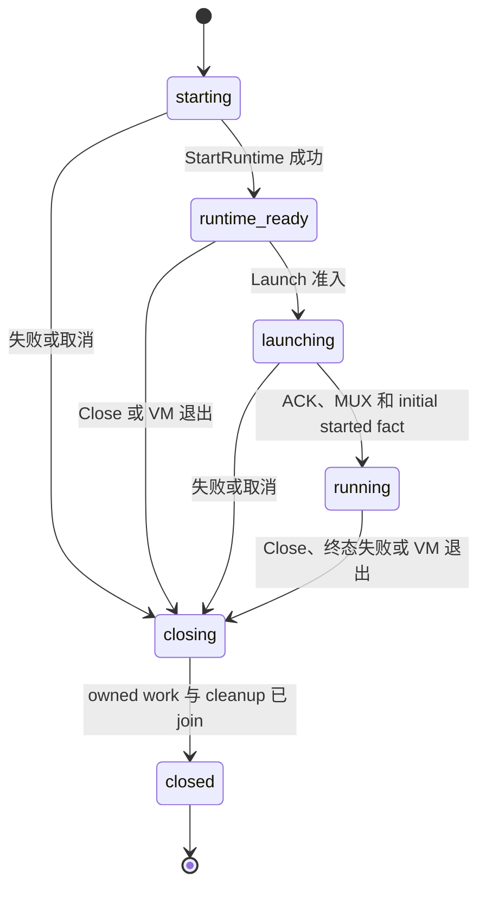

[English](runtime.md) | [简体中文](runtime_zh.md)

# Runtime：启动、控制、捕获与恢复

`pkg/runtime` 是持有单个 MicroVM 的公开 Go 入口；`sandbox-ctl` 将相同操作适配为 Host CLI。
本页按 Runtime 对象的一生组织：准备输入、创建基础 runtime、启动工作负载、执行或捕获、关闭。
操作与状态前提，以及 Guest、VMM、内存、磁盘和资源控制器之间的协调，均由本页定义。

首次独立使用时，先按 [README](../README_zh.md#构建与测试) 构建二进制，准备内核、runtime Bundle
和 flatten 后的工作负载镜像，再生成[配置](configuration_zh.md#render-config)。
按[运行示例](#run)选择显式冷启动、从 E 冷启动或从 S 恢复。捕获后使用新的 SandboxID
可以创建独立实例；当前没有单独的运行中 fork CLI 或 SDK，这一流程由
`snapshot --resume` 与 `run --restore` 表达。

| 任务或边界 | 阅读入口 |
| --- | --- |
| 嵌入 `StartRuntime`、`Launch`、`Start`、`Restore` 与所有权 | [Runtime SDK](#runtime-sdk) |
| 运行、exec、snapshot、在线 export | [运行](#run)、[exec](#exec)、[snapshot](#snapshot)、[export](#export) |
| 跨资源捕获与 Host 控制 socket | [捕获屏障](#capture-barrier)、[控制协议](#control-protocol) |
| 离线组装、reset、检查与发布 | [制品](artifacts_zh.md) |
| 磁盘 checkpoint list/delete/GC 与 `Disk` API | [块存储](block-storage_zh.md#checkpoints) |
| Usage 命令与资源计量 | [资源](resources_zh.md#usage-cli) |

本指南对应当前源码。平台发行版可能选择不同组件版本，应使用该版本附带的指南及匹配制品。
当前 reader 拒绝旧 `snapshot.cfg` 磁盘图 schema；不提供双 reader、自动迁移或任意版本恢复保证。
具体见[制品兼容性](artifacts_zh.md#compatibility)。

<a id="standalone-workflow"></a>

## 完整独立使用流程

先准备本地绝对 kernel 路径、匹配 runtime Bundle、flatten 后的 EROFS 工作负载镜像和可挂载的 ext4 upper
源。必须有已格式化 template、已有 diff 或 immutable upper；`run` 不负责把空白文件格式化。
以下流程假定这些输入已绑定到 `sandbox.yaml`，且所选工作负载持续运行。本地操作要求
[构建与运行前提](../README_zh.md#构建与测试)列出的 Linux/KVM 权限。

1. 生成并编辑完整注释模板，然后校验：

   ```bash
   sandbox-ctl config --template -o sandbox.yaml
   # 设置本机 kernel、runtime、image、ext4 source 和工作负载。
   sandbox-ctl config --config sandbox.yaml --check strict
   ```

2. 在一个终端启动 runtime：

   ```bash
   sandbox-ctl run --config sandbox.yaml --sandbox-id demo-1
   ```

3. 在另一个终端执行工作负载中确实存在的命令，然后捕获可复用 snapshot，并继续原实例：

   ```bash
   sandbox-ctl exec --sandbox-id demo-1 -- /bin/sh -c 'printf "guest ready\n"'
   sandbox-ctl snapshot --path-id demo-1 --output ./artifacts --resume
   ```

4. 投影仅含 Host 字段的恢复配置，创建独立实例：

   ```bash
   sandbox-ctl config --config sandbox.yaml --mode restore -o restore-host.yaml
   sandbox-ctl config --config restore-host.yaml --mode restore --check strict
   sandbox-ctl run --restore ./artifacts/demo-1.snapshot \
     --config restore-host.yaml --sandbox-id demo-2
   ```

Snapshot 命令会报告已提交根引用；若输出模式或位置不同于这个 local 示例，应使用实际返回 ref。
将 Host 配置用于另一个 SandboxID 前，要检查当前实例网络身份和可写路径。关闭某个 runtime 只释放它的
所有权；销毁 runtime 不授权删除共享不可变依赖。只需要冷启动 E 而无需内存状态时，使用[在线 export](#export)；
希望完全不启动 VM 时，使用[离线组装](artifacts_zh.md#assemble)。

<a id="runtime-states"></a>

## Runtime 状态与操作生命周期

[`Runtime.State`](../pkg/sandbox/runtime_sdk.go)暴露下列名称。这是 Runtime owner 的状态，
与 Guest launch fact、节点资源协议状态不同。



纯 Launch 校验失败可以保留 `runtime_ready`，让调用者修正输入；一旦进入 launching，失败即为终态。
`Stats` 可观测 ready base；`Exec`、`Snapshot`、`Export` 要求工作负载 running。`Restore` 直接重建已有
应用并返回相同公开 owner 类型，不执行新冷 Launch。`Wait(ctx)` 只等待；`Close` 请求停机并 join 保留的
退出结果。后文给出源、context、descriptor 和 callback 的详细所有权契约。

<a id="operations"></a>

## 操作入口

命令按实际操作归属查阅：

| 命令 | 权威章节 |
| --- | --- |
| `run` | [runtime](runtime_zh.md#run) |
| `exec` | [runtime](runtime_zh.md#exec) |
| `snapshot` | [runtime](runtime_zh.md#snapshot) |
| `export (live)` | [runtime](runtime_zh.md#export) |
| `export --from` | [artifacts](artifacts_zh.md#assemble) |
| `reset` | [artifacts](artifacts_zh.md#offline-reset) |
| `checkpoint list/delete/gc` | [block-storage](block-storage_zh.md#checkpoints) |
| `usage` | [resources](resources_zh.md#usage-cli) |
| `config` | [configuration](configuration_zh.md#render-config) |
| `info` | [artifacts](artifacts_zh.md#inspect) |
| `publish / upload-snapshot` | [artifacts](artifacts_zh.md#publish) |

`upload-snapshot` 是 `publish` 的兼容别名。恢复使用 `run --restore`；没有独立的 `restore`、`pause`、`resume` 或 `stats` 子命令。

<a id="runtime-sdk"></a>

## Runtime SDK 与显式冷启动

一等 Go API 位于 [`pkg/runtime`](../pkg/runtime/runtime.go)：

```go
StartRuntime(ctx, RuntimeSpec) (*Runtime, error)
(*Runtime).Launch(ctx, LaunchSpec) error
Start(ctx, SandboxSpec) (*Runtime, error)
Restore(ctx, RestoreSpec) (*Runtime, error)
```

`Start` 依次执行 `StartRuntime` 和 `Launch`；launch 失败时关闭内部创建的 owner。
`Restore` 直接重建快照中的内存、CPU/设备状态和工作负载，在既有 restore ACK 与
MUX 屏障后返回同一种 live owner。它不会先冷启动，也不要求旧快照发送
`runtime_ready`。CLI 将既有 config/`--from` 输入转换为 SDK spec；跨进程管理命令
继续使用本地控制传输。

从 Sandbox 制品冷启动时，使用
[`sandbox.OpenRunSource`](../pkg/sandbox/run_source.go)(ctx, ref, storage, locations)
和 `source.Apply(host, presence, config.ApplyFromOptions{...})`。Apply 返回生效配置与
携带 portable C0、checkpoint provenance 和成对 Bundle selector 的 `LaunchSpec`，
复用 CLI 的来源解析、默认 boot 绑定与 presence-aware override 规则，不修改 host
配置，也不提前重复绑定磁盘图。source 和借用的 storage 必须保持打开，直到 runtime
退出且 `Wait` 报告退出结果，或 `Close` 完成；取消 `Wait` 不结束借用。使用 `ReplaceBoot` 时，结果不保留 source provenance 或 scoped
selector，Apply 后即可关闭 source；返回结果中的 storage 仍为借用。这些 helper
不启动 VM，也不获取 checkpoint writer。启动前由调用方另外设置 runtime host
选项、stdio 与 forwards。

把完整的 `LaunchSpec` 传入
`sandbox.DeriveRuntimeSpecWithOptions(ctx, cfg, sandbox.DeriveRuntimeOptions{Launch: launch, ...})`，
再将返回的 shape 和同一个 launch 值交给 `Start`，或依次调用 `StartRuntime`、
`Launch`。Derive 读取磁盘容量，冻结已打开 source 的 identity、C0 boot refs 与选定的
host boot 路径，不打开 host kernel/runtime 文件。`StartRuntime` 检查启动当时的
元数据，采用与 `run --from` 相同的 portable identity 策略。Apply 后改变来源
provenance 或 C0 boot refs、Derive 后改变 host boot 路径，都会被拒绝。
复制返回值会保留绑定；用 `LaunchSpecFromConfig` 重建公开字段不会。
手工构造的 shape/source binding 和 `ReplaceBoot` 继续采用严格 identity 策略。
来源记录不额外持有 reader、storage 或 checkpoint pin。

`RuntimeSpec` 包含 kernel/Bundle 绑定、CPU/内存及资源策略、宿主
TAP/provider/namespace 要求、console/control 设置和有序的 `RuntimeDiskSpec`。
每个逻辑盘固定名称、single/overlay 布局和逻辑容量。Overlay 展开为只读 base 加
可写 upper，single 展开为一个可写设备。所有设备固定使用既有最小 virtio feature
集合，不涉及设备热插拔。

CH 启动前，从 `<配置的 kernel 路径>.sha256` 精确解析 kernel identity。
sidecar 是可选、可读的普通文件，上限为 4 KiB。内容只能是一条 64 位十六进制 SHA-256
摘要，或使用配置的 kernel basename 的一条无标签 sha256sum 记录
（`<digest>  vmlinux` 或 `<digest> *vmlinux`）。接受 LF/CRLF 和一个末尾换行；
多条记录、多余字段、路径和格式错误均导致启动失败。存在但无效、不可读、非普通文件或
指向不存在目标的 sidecar 都是错误。真正不存在时，显式 cold projection 或未绑定
prepared source 的 shape 完整计算一次 kernel hash；source 派生的 portable startup
仅把 C0 kernel ref 保留为祖先记录，不计算 hash。
部署时可在尚未启用的版本目录中对最终**原始** kernel 执行
`sha256sum -- vmlinux > vmlinux.sha256`，并一致地安装这一对文件。
sidecar 是受信的部署元数据；Sandboxer 不会根据 CH 加载的字节重新计算摘要。
runtime Bundle identity 仍取自 footer。版本专属的 kernel 与 sidecar binding
必须从 identity 解析到 CH 实际启动使用期间保持稳定；只切换 `current` 符号链接
不能固定进行中的启动所做的全部路径查找。应使用稳定版本路径或协调切换。
启动既不生成也不缓存 sidecar；portable startup 在 CH 启动前将已有 sidecar 与 C0 比较。

`LaunchSpec` 包含工作负载 root/data artifact 引用与可写路径、Guest
IP/MTU/路由/hostname/interface、mounts、持久与临时 files、init、完整 process 配置
（含 plugins、user、restart、PID namespace 和 cgroup delegation）、stdio、forwards
及 artifact 访问上下文。`LaunchSpecFromConfig` 保留完整配置 ABI。
`Credentials` 通过 `ArtifactCredentials{Config, CustomerKey}` 创建自有 storage，
不读取或修改环境变量。也可借用 `Storage`、`Fetcher` 和 Bundle selector；调用方必须
保持它们打开且不变，直到 `Wait` 返回退出结果或 `Close` 完成；取消一次 `Wait`
不结束借用。Runtime 释放 SDK 创建的 reader、storage 和
自动 diff，不删除调用方指定的 diff/template 路径。继承的 cgroup 和 forwarding FD
采用借用或复制方式。Kernel/Bundle 路径及 artifact 输入在借用期间必须保持可读且不变；
SDK 通过 TAP handoff 收到的 FD 归 Runtime 所有。Forwarding
socket 路径必须尚未使用；已存在时 bind 失败，不删除原路径。

基础启动在 CH boot 前建立未绑定设备。元数据可用，但数据请求立即以 IOERR 完成；
未绑定请求不伪造零、不无限重试，也不成为 runtime-fatal storage error。
Launch 先准备并验证全部 backend，再以一个原子发布点绑定整个集合。每个分段 virtio
请求只使用同一个 binding view。发布后 Guest 才组装工作负载 root 并 switch root。
绑定后的 backend 保留 COW writeback fatal hook、context-aware I/O、统计和 snapshot view。

`Launch` 只接受一个工作负载。纯输入/状态校验失败可不消耗机会；进入 `launching`
后失败或取消会终止 Runtime，不能替换为另一个工作负载。绑定本次 token 的初始 started 事实通过 ACK/MUX 屏障后，
与 Close、取消和 CH exit 一起确定唯一 launch 成功结果。它保留既有启动就绪语义，
不证明目标 execve 成功或应用健康。`runtime_ready` 后等待分配工作负载的时间不计入
launch 执行超时。基础 Runtime 保持资源 reservation、controller heartbeat 和资源统计，
但不会在 launch 前报告工作负载 ready 或 Settled。

SDK 冷启动在 `launch.start_timeout` 与操作 context 下等待 `launch_ack`。
ACK 后 `timeouts.app_start` 是可选整体期限：省略、空值或 `0` 不增加期限；
正时长选择有界等待；负数/非法值为配置错误。仅正数创建 timer。
`DefaultAppStartDeadline` 保留为已弃用零常量，不可无条件传给 NewTimer。
Socket `timeouts.app_notify` 和其他阶段策略保持各自语义。

Host 提供唯一初始 Launch token。Guest 在真实启动/终止边界记录 pending、started、
failed 或 exited。快速 app_started 和既有 Pinger 的已校验 Pong 将同一事实送到
统一确认入口。PID 存在、Ping 可达或 restore 的固定 running 字段都不充分。
成功要求 ACK 和 MUX；failed/terminal 也可结束 ACK 前等待。旧 token 被忽略，
非法状态失败，迟到 started 不能覆盖确定终止错误。

Commit 按既有 readiness/Runtime 锁顺序检查 owner/operation 取消、Runtime 状态、
永久读取错误与当前事实；在用户回调前发布内部完成信号。回调阻塞不影响 Launch、
Pinger Pause/Stop 或管理连接 join。Pinger 仅发布有界事实，回调在 tick 外、通知
连接关闭后执行。成功与期限/取消/退出保留唯一线性化结果。

新 Launch 在 LaunchSpec/apply 前要求 runtime-ready hello 的
`initial_launch_state_v1`。需一起构建 sandbox-init 和 runtime Bundle；用于新
Launch 的预热 Guest 同样升级。缺能力明确失败，不回退两秒策略。旧 Host 忽略
Guest 新字段。已有应用的普通 restore 保留 restore/attach 语义，不消费旧 token
作为新 Launch 事实。Host 升级无法替换 snapshot 中的 init。Primary restart 保持
已完成初始事实及原监督/通知语义。

当前支持的预热边界是仍存活的 `runtime_ready` 实例随后执行 Launch。SDK 在
running 前拒绝 Snapshot/Export；尚无工作负载的 Guest 拒绝 restore/attach/quiesce。
“保存预热内存、恢复后再 Launch”不是已实现的 API。若其他生命周期提供这种状态，
新 Launch 仍须满足 Guest 能力要求；这不代表可以升级旧 snapshot 内的 init。

默认 PingFatalThreshold 仍为零。无限恢复可能持续持有资源，直到取消/Close、
永久错误或真实 VM 退出。正数 AppStart 或显式 PingFatal 选择有界终止，不能同时
保证无限恢复。Portable 制品不含宿主策略，Builder 保留外层 work deadline。

Operation context 限定 startup、launch、restore、live operation 和单次 wait。
成功返回后取消 startup/launch context，不会杀死 Runtime 或使后续 lazy read 失效。
取消 `Wait(ctx)` 只取消该次等待；清理后重复 Wait 观察同一份保留的 `ExitResult`。
并发、幂等的 `Close` 由唯一 owner 请求优雅 VMM shutdown，在 CH exit 前保持 backend
存活，等待自有工作退出后释放 storage。SDK 不安装 OS signal handler。CLI 注册
SIGTERM/SIGINT，并保留第二次 signal 立即升级的行为。CLI 也通过
`stdio.Mode.WindowChanges` 提供 SIGWINCH；SDK 只消费该 channel，不注册 signal。
清理会取消并等待空闲 input pump，不关闭继承的 stdin。桥接期间每个输入 FD 只有一个消费者。

Live `Exec`、`Snapshot`、`Export`、`Stats` 直接调用 owner。Exec 返回调用方负责关闭的
Guest MUX connection 及协商后的 stdio spec。Capture 复用既有 `ctl.Request` 选项和
E/S 输出 schema，不序列化为 CLI 命令。Exec 与 capture 要求工作负载已运行；资源统计
也可在基础状态使用。SDK 不包含 scheduling、placement 或 runtime pool 策略。

普通 CLI adapter 在启动基础 Runtime 前预检已知工作负载输入；使用拆分 API 的调用方
可稍后提供这些输入：

```text
StartRuntime: 校验 shape 和 boot binding；保留 host identity 事实与 source 祖先记录
  -> 预留资源并获取宿主网络
  -> 创建 memfd/UFFD、固定未绑定 vhost 设备及 control server
  -> spawn CH -> Guest 基础初始化 -> runtime_ready
Launch: 解析工作负载输入，并从已保留的宿主 identity 形成完整、不可变的 portable C0/provenance
  -> 准备全部 storage -> 校验全部设备 -> 发布 binding
  -> 发送 launch -> 组装工作负载 root -> switch root/configure
  -> launch_ack/MUX -> app_started/ready
Close 或 exit: 回收 CH -> 等待自有服务/工作退出 -> 关闭保留的资源
```

CLI preflight 中可预测的 config/ref/format 错误仍在 VM 副作用前失败。拆分 launch
必然在基础 VM 已存在后解析工作负载 artifact。C0 在完整 launch 输入已知时写入一次，
早于 Guest 消费工作负载，之后保持不变。`runtime_ready` 后 Launch 不再查询
kernel、sidecar 或 Bundle identity，即使这些路径名发生变化；新 Runtime 会重新解析。
对 source 派生的 shape，`Start` 在创建 VM 前验证匹配的 source/C0；分阶段
`Launch` 在 checkpoint 合法物化、改变磁盘图和 provenance 前检查同一绑定。
来源输入被拒绝时，ready base 仍可接受修正后的 `Launch`。没有 sidecar 时，C0 kernel
ref 仅作为祖先记录，不会被报告为已验证的 host digest；有 sidecar 时，不匹配会在
CH 启动前失败。手工 shape（包括只手写 `SourceBinding` 或 `PortableConfig` 的情况）
仍解析完整 host identity，比较 C0 中两个完整规范 ref，含 basename；没有 sidecar
时计算一次 kernel hash。不带 `SourceBinding` 的本地 `PortableConfig` 仍受支持。
CLI 显式 cold `run` 与 `--replace-boot` 经 `Start` 复用 preflight identity，避免二次
扫描。Restore 不读取 sidecar，也不要求 cold-start projection。
这一身份保留规则不允许改写运行中 runtime Bundle 的 pmem 后端内容；
Bundle 的既有生命周期要求仍然适用。

<a id="run"></a>

## `sandbox-ctl run`

runtime 自己持有 `<RunRoot>/<PathID>/<SandboxID>.pid` 及其进程关联的 POSIX 锁。cold、`--from` 和 restore 在发布运行文件、资源准入之前取得该身份；竞争启动失败不得截断已有 PID 文件或删除存活实例的 RunDir。目录清理完成后才释放身份锁。这是执行身份，不是另一套资源预留。旧的同 PID exec 启动方式仍可使用；常驻任务父进程不能冒充 runtime PID 文件的所有者。

三种输入模式严格分离:

```bash
# Explicit cold start.
sandbox-ctl run --config sandbox.yaml --sandbox-id s1

# Cold start from Sandbox E.
sandbox-ctl run --from ./s1.sandbox --config host.yaml --sandbox-id s2

# Cold derivation from Sandbox E defaults with a completely new boot graph.
sandbox-ctl run --from ./s1.sandbox --replace-boot \
  --config replacement.yaml --sandbox-id s2-rebased

# Resume memory execution state from Snapshot S.
sandbox-ctl run --restore ./s1.snapshot --config restore-host.yaml --sandbox-id s3
```

RunRoot/BaseRoot 是调用级根目录，RunDir/BaseDir 是本次 Sandbox 的实际目录。
`SandboxID` 始终是逻辑身份；`PathID` 仅是两个 root 下共同使用的目录 leaf：

```text
pathID  = PathID（若显式给出），否则为 SandboxID
RunDir  = RunRoot/pathID
BaseDir = BaseRoot/pathID
```

例如 Build phase 可保留全局唯一 SandboxID，同时使用固定私有目录：

```bash
sandbox-ctl run \
  --config phase-a.yaml \
  --sandbox-id build-01-phase-a \
  --path-id a \
  --run-root /run/sandbox/builds/build-01 \
  --base-root /var/lib/sandbox/builds/build-01
```

PathID 必须是非空、安全的单一路径分量，不能是 `.`、`..`，也不能包含
`/`、`\\` 或 NUL。它不与 SandboxID 比较，也没有 PathID→SandboxID 映射。
root/data disk 的默认 writable diff 位于 PathID 派生的 BaseDir，但文件名继续
使用逻辑 SandboxID，例如
`BaseRoot/a/build-01-phase-a.overlay.diff` 与
`BaseRoot/a/build-01-phase-a.disk0.diff`。cold、`--from` 和 `--restore` 使用同一
规则。Sandbox 正常退出只清理当前 PathID 的 RunDir 和 owned diff；不会递归
删除传入的 RunRoot/BaseRoot 或 sibling PathID。

`--from` 与 `--restore` 互斥. `--config` 在三种模式中的所有权不同:

- 普通 run:完整显式 cold config.
- `--from`:host/instance overlay;portable workload 来自 E.
- `--from --replace-boot`:E 只提供 non-boot portable defaults;host config 必须提供完整 boot.
- `--restore`:host-only restore bindings/policy;执行状态和 portable workload 来自 S 引用的 E.

`--config a.yaml:b.yaml` 继续按顺序 merge. `SANDBOX_CONFIG` 可替代 `--config`. `LoadConfigBytesWithPresence` 为 config-socket 等内存入口提供相同的 presence-aware 规则.

`--from` 和 `--restore` 支持:

- raw absolute/relative local path;
- scheme-qualified local tarstream;
- `manifest://<key>`;
- `file://<bundle>@manifest:<key>`;
- Bundle 默认 root key 推导;
- named `--ref-location name=file:///absolute/path`.

`run` 的 stdio、TTY、console、`--ready-fd`、connect forward 和资源参数在三种模式中保持相同 host 控制语义. Memory restore 不重新发送 cold launch spec.

<a id="restore"></a>

## Memory restore 数据流

`run --restore S` 只处理真正的 memory Snapshot:

```text
T0 parse host config with presence
T1 open carrier and strict-parse S
T2 parse canonical snapshot.cfg
T3 open S.sandbox_ref and strict-parse E
T4 apply restore host-only rules to E config -> immutable lifecycle C0
T5 preflight kernel binding, compare runtime identity, and check disk sources
T6 atomically write run-dir C0
T7 bind self and reconstruct root/data disks from E
T8 create memfd and layer S.memory over S.from_refs
T9 create UFFD/va_report endpoints and CH restore argv
T10 start CH from config.json/state.json
T11 transfer UFFD descriptor(s) and complete restore handshake
T12 轮询 GET /vm.info，直到已恢复 VM 明确处于 Paused
T13 /vm.resume
T14 establish restore MUX and resume original process
T15 settle balloon/resource observation
T16 start pinger,forward,sensor and steady lifecycle
```

Cloud Hypervisor v51.1 会在 CLI 提交 `VmRestore` 前绑定 API socket，因此 socket
可连接不代表 restore ready。`vm.info` 的 Paused 检查是既有外部 `/vm.resume`
之前的正确性 barrier；只有该版本的结构化 VM-not-created 响应和 socket 尚未监听
可视为 pending。`timeouts.api_ready` 覆盖整个 barrier，包括连接成功但响应阻塞；
`timeouts.ch_api` 独立约束后续 resume 响应，`timeouts.restore` 独立约束 Guest
restore ACK 与 MUX 建立。这完成 #72 的 restore-readiness 正确性部分；消除 resume
往返仍是未来优化，并且需要兼容的 Cloud Hypervisor 版本。

Restore不会:

- 从 `snapshot.cfg` 读取 disk graph;
- 对 zero memory执行 cold start;
- 重跑 init/files/launch/plugin;
- 把 E的 `config.json` 当成新的 process launch request;
- 更新 memory parent或C0作为 re-snapshot side effect.

Host-only允许项包括 network provider/current identity、cgroup/controller、allocatable CPU/memory 与 resource enforcement、kernel/runtime actual path、active diff/template、restore prefetch和timeouts. Immutable disk graph、capacity identity、`deflate_on_oom`、network topology 由 E 拥有。Kernel 重哈希例外与 runtime-footer 比较见 [PortableSandboxConfig](artifacts_zh.md#portable-config)。

Runtime 选择只发生在 restore 预检查中。首先检查传入的 `boot.runtime` 文件，
沿用既有 bundle 封装校验，并将 **basename + 尾部声明的 digest** 与 E 比较。
成功立即使用，不访问第二候选。若文件缺失、不可读、格式错误或 identity 不匹配，
只尝试一个同目录文件：传入路径的父目录加 E 中已经验证的 runtime basename。
不按默认文件软链接的目标改变查找目录，不扫描目录，也不重复检查相同候选。
两个候选执行相同校验；均失败时保留两次原因。非法配置、取消以及后续磁盘、网络、
VM 错误不触发 runtime 回退。未提供 runtime 绑定时，保留既有本地 E 来源目录默认绑定。
不新增目录配置字段；image 冷启动与 `--from` 行为不变。

无论哪个候选通过，都将选定的本机绝对路径同时用于本次 runtime 绑定和生成的
`snap-state/config.json` 中的 `pmem[0].file`。捕获的 pmem 必须符合既有单 runtime
设备结构，且 file 字段非空。只改变该 file 字段，设备 ID、可选 size 及其他属性、
`state.json`、原始 S/E 和节点默认配置均不改变。旧绝对路径无需存在。
同目录自动回退要求不同版本 runtime 以不同文件名保持不可变且可用；显式匹配的
旧文件绑定也可使用独立版本目录，见 [v1/v2 升级示例](https://github.com/kuasar-sandbox/guest-runtime/blob/main/docs/runtime-bundle_zh.md)。恢复不新增
整份 EROFS 重哈希或 runtime 复制。既有 `snapshot.restore.sh` 验证 v2 名称默认文件
回退到已迁移的 v1、捕获旧路径不可用、pmem 选定路径、源制品与 host 输入不变，
以及 Guest ready 和执行继续。

从 S0 restore后:

```text
C0 = E0 portable config
memory parent = S0

next snapshot:
  E1 = Export(C0,current disks)
  S1 = memory self + from_refs=[S0,...] + sandbox_ref=E1
```

从 explicit cold或E cold start后,memory parent为空. `snapshot --resume`不偷偷把 S1设为当前 parent.

<a id="exec"></a>

## `sandbox-ctl exec`

```bash
sandbox-ctl exec --path-id a --run-root /run/sandbox/builds/build-01 -- /bin/sh -c 'id'
```

local exec 可只给 `--path-id`；若同时给
`--sandbox-id build-01-phase-a --path-id a`，仍只拨号
`RunRoot/a/ctl.sock`，请求本身不增加 SandboxID 或一致性检查。未给 PathID 时
继续使用 `RunRoot/SandboxID/ctl.sock`。

`exec` 通过当前 ctl/MUX 创建 sibling process. Export/snapshot 的 quiesce gate 原子阻止新 exec/forward 进入不稳定窗口,并关闭、join 已放行的 exec/forward session;在飞 exec 被终止且不会在 `--resume` 后自动重跑. Restore/attach 先 thaw 应用 cgroup 并重新开放 exec、forward、plugin 和 app restart,再发送 ACK. Host 在 ACK 与本端 MUX 建立后发布 ready,不会暴露仍处于 quiesce 的 exec gate. Guest mem_report 仅在 ACK 与 guest MUX 建立后恢复. Thaw 失败不发 ACK;ACK 失败不撤销已经完成的 thaw,仍由现有 host recovery/terminal-cleanup 路径负责. Guest `attach` 是幂等恢复操作;host 在 request/ACK 边界不明确时立即重试一次,且整个 dial/ACK 过程受 lifecycle context cancellation 控制.

远程授权 exec 使用 `pkg/ctl.ServeExecTunnel(ctx, options)`,固定以下顺序:

```text
Authorize -> AcceptDownstream -> ReadExecRequestFrame -> AuthorizeRequest
          -> DialBackend -> write frame.Raw once -> duplex relay
```

Request gate 通过前不得拨号 backend 或触发 Sandbox lifecycle. 首帧的 JSON payload 上限为 64 KiB，另有四字节长度前缀；必须是单一、字段集严格且无 duplicate 的 `exec_request`，包含非空 `exec.argv` 数组；读取最多等待 10s,调用方只能缩短. 通过后原始 frame 只写入一次,不 decode/re-encode. 已识别的 request/backend rejection 只对外返回脱敏 `exec request rejected`;`ProxyExec` 仅保留给已预连接 backend 的调用方.

<a id="snapshot"></a>

## `sandbox-ctl snapshot`

以下为命令语法；实际执行时选择一种 output 方式，并省略方括号记法：

```text
sandbox-ctl snapshot \
  --path-id a \
  --run-root /run/sandbox/builds/build-01 \
  (--output /artifacts | --upload) \
  [--mode local|bundle] \
  [--resume] \
  [--drop-caches=false] \
  [--merge-ref=true]
```

Snapshot 始终包含 memory execution state. 一次操作在同一 freeze point 产生 E 和 S,S 最后 commit. 默认成功后销毁 VM;`--resume` 恢复原 VM,但不把新 E/S 设为 live baseline.

Local human output同时列出 `Snapshot S` 与 `Sandbox E`. Upload stdout 仍只输出 S Manifest key,便于当前 orchestrator parser 使用. `snapshot_done` 同时返回 `snapshot_ref` 与 `sandbox_ref`;既有 `memory_size`、`memory_resident`、pause/dump timing 和 compatibility `overlay_*` response 字段保留. `overlay_*` 当前镜像 E identity,真正 disk graph 只在 E 中. 既有字段名 `memory_resident` 统计显式逻辑内存覆盖量（Data 加 Zero），包括保留为 Zero 的释放页；它不表示物理驻留量或编码后的 payload 大小。

Capture 的 `snapshot --json` 恰好返回 `{snapshotRef,sandboxRef,removedRefs}`，
`export --json` 恰好返回 `{sandboxRef,removedRefs}`，capture 的 `removedRefs` 固定为
`[]`。身份直接来自成功的 runtime 响应（`export --from` 则来自 assembly 生产者）。CLI
不重新打开 S，也不根据扩展名推断 E。单根 Bundle 的两个 selector 都绑定实际最终
Bundle 文件；upload Snapshot 返回两个实际 Manifest 身份。本地引用仅公开 basename，
保留 `@digest`、`@hmac`、`@manifest` 及已有 location，输出目录留在调用方执行上下文。
缺失或无效的响应返回错误，不输出成功 JSON。`--resume` 使用同一身份契约；不带
`--json` 时继续保留原有人类可读输出和 upload key stdout。

RFC-142 配对部署必须同时升级 sandboxer 与 orchestrator。操作员升级前须清空旧
orchestrator 本地数据库并重新创建记录；两个组件均不迁移、不回填，也不自动删除用户
数据。缺少必填 `resumeSandboxRef` 字段的旧迁移 token（包括缺少 E 的 Snapshot token）必须废弃，从完整 S/E 记录重新签发。portable
Export 即使在工件不可用时也只使用已记录的对，绝不读取 S 来发现 E。

`--drop-caches` 只属于 memory snapshot,默认 false. `--merge-ref=false` 独立录制当前工作集并保留一个历史合并层；true（默认）将累计变化与本沙箱 checkpoint 的本地历史前缀合并。两者均在外部归属处停止，磁盘合并不受该开关影响。完整规则见[checkpoint 历史与清理](artifacts_zh.md#checkpoint-history)。

local `snapshot` 只需 `--sandbox-id` 或 `--path-id` 之一。两者同时给出时
PathID 只选择 `RunRoot/PathID/ctl.sock`，不做身份一致性校验。`--output` 可以位于
BaseRoot 文件系统（例如 `BuildBaseDir/checkpoint`）；运行进程只清理自己的
RunDir/owned diff，不会把 output 当作运行目录删除。

<a id="export"></a>

## `sandbox-ctl export`

在线 export 从运行中工作负载生成可冷启动的 Sandbox E：

```text
sandbox-ctl export \
  --path-id a \
  --run-root /run/sandbox/builds/build-01 \
  (--output /artifacts | --upload) \
  [--mode local|bundle] \
  [--resume]
```

Live mode 拒绝 `--config`，复用当前 run 进程已验证的 Manifest/ref-location/crypto binding。
显式 `--manifest-config` 和 `--ref-location` 属于[离线组装](artifacts_zh.md#assemble)。
`--timeout` 限制客户端等待 ctl socket 的时间，零关闭该 CLI 限制；不增加服务端 deadline。
Export 不接受 `drop_caches` 或 memory-merge 参数，不调用 CH `/vm.snapshot`，不读取 memfd，
也不生成 memory ref。

与本地 snapshot 相同，在线 export 可只给 PathID；同时给出 SandboxID/PathID 时，PathID 只定位
ctl socket。默认成功后销毁 runtime；`--resume` 遵循共同捕获恢复顺序。不启动 VM 的 image-to-E
操作使用独立的组装流程。

<a id="capture-barrier"></a>

## Freeze sequence 与 failure recovery

所有 predictable preflight在 guest freeze 前完成:

```text
T0 output/manifest/local-crypto/ref/Bundle/merge/config/source preflight
   Close usage admission and break Gauge continuity before the resource barrier.
T1 enter MemoryController/Budget mutation barrier
T2 lock and lift/drain memory.high
T3 pause pinger and gate new host exec/forward;guest drains exec/forward and mem_report, freezes app, syncs,
   closes MUX;after quiesced+EOF host joins residual exec/forward handlers
T4 pause CH, quiesce all block backends
T5 capture every data disk exactly once
T6 build C1 from immutable C0 + source binding + captured disk refs
T7 capture root once and emit Sandbox E
```

Export continues:

```text
T8 commit E last
T9 destroy, or --resume backend -> CH -> MUX/pinger/forward -> app -> barrier
```

Snapshot continues in the same T4 freeze:

```text
T8  CH /vm.snapshot -> config.json/state.json
T9  scan/capture memory self
T10 build S(snapshot.cfg.sandbox_ref=E, from_refs=memory parents)
T11 commit S last
T12 destroy, or --resume full recovery
```

Export固定不执行 drop_caches,不调用 `/vm.snapshot`,不读取 CH snapshot files或 memfd. Snapshot只读取一次 disks,不会先为 E捕获一次再走旧 disk path第二次.

Disk SnapshotView只在 backend quiesced时稳定. V1在整个 sink read窗口保持 VM paused;不能恢复 VM后继续读取 view.

Failure semantics:

- Data artifacts/E 可能成为 content-addressed orphan。回收属于 owning storage/retention policy；sandboxer 不保证自动、按完整图回收 local output 或 shared location。
- Root alias只在 E或S成功后提交.
- `--resume` success/failure按 backend -> CH -> MUX -> pinger/forward -> app -> resource barrier恢复.
- `attach` ACK不明确时host幂等重试一次;若仍不能重建MUX,该capture变为terminal failure,host在memory/memory.high guards仍持有时请求VMM shutdown,再以SIGTERM/SIGKILL有界兜底. 失败不会留下可接受新请求但guest仍冻结的VM.
- 默认destroy也等待CH退出;`/vmm.shutdown`失败或超时后使用SIGTERM/SIGKILL有界兜底,然后才释放lifecycle guards.
- C0、active diff和live lower graph保持不变.
- Local capture 使用 same-directory temp 并清理失败的 partial output；named-location publication 使用 [Local tarstream 与 crypto](artifacts_zh.md#artifact-publication) 的独立所有权检查与清理规则。

销毁模式的 snapshot/export 成功提交后，ctl 所有者必须先完成带长度前缀的响应写入，再发起 VMM shutdown；固定 sleep 不能充当响应交付屏障。仅最终响应写入受五秒上限约束，不为捕获本身增加 deadline。调用方已断开或不读取时，写入失败后仍继续正常销毁已提交的捕获；CLI 必须报告传输错误，不能根据文件存在推断成功。进程内的 `Response.AfterWrite` 不进入序列化协议，`ctl.Server` 在写完或写失败后调用它；直接调用 handler 的代码承担相同责任。该延续最多发起一次销毁，并保持 Budget 与 `memory.high` 生命周期屏障，直到现有有界 CH 退出流程完成。`--resume` 与捕获失败恢复行为不变。

<a id="disk-capture"></a>

## 共同冻结下的磁盘提交

Quiesce等待in-flight block request退出并阻止新request. 所有data/root views在同一quiesce窗口读取. Recovery顺序先恢复backend可服务状态,再恢复CH和guest连接,避免VM恢复后block request永久阻塞.

命名磁盘捕获先等待所有磁盘模板 `WaitReady`，再暂停 CH 并冻结后端。在同一冻结
屏障内，各盘排空已准入的 cache 写入，等待最终 `Materialized` 发布（包括初始
Sync/rename），然后登记指定 ID。所有磁盘成功后才生成无 payload 的 E，并提交操作
根：export 提交 E，snapshot 则在内存捕获后提交 S。前端准入冻结时，writer 和
materializer 仍可完成工作，避免排空与模板物化互相等待。

尝试根 Commit 之前失败，会删除已知由本次创建的版本，并沿用正常捕获恢复流程。
一旦尝试 Commit，结果就可能不确定：后续 Commit、Close、Resume 或响应错误都
保守保留磁盘版本，不将已有产物或运行基线回滚到历史根。捕获中断可能留下可见版本；
应列举并删除它们的精确身份，重试捕获时使用新 ID。仅客户端传输失败不能证明没有
产物或版本提交。

<a id="control-protocol"></a>

## `ctl.sock` protocol

socket 固定位于 `RunRoot/PathID/ctl.sock`；PathID 省略时等于 SandboxID。
PathID 是 host-side 定位参数，不进入以下 wire request：

Snapshot和export使用独立 request type:

```text
snapshot_request -> snapshot_done | error
export_request   -> export_done   | error
exec_request     -> exec_ack      | error
usage_request    -> usage_response | error
resource_stats_request -> resource_stats_response | error
checkpoint_snapshot_request -> snapshot_done | error
checkpoint_export_request   -> export_done | error
checkpoint_list_request     -> checkpoint_list_chunk* -> checkpoint_list_done | error
checkpoint_delete_request   -> checkpoint_delete_done | error
```

命名捕获使用专用 checkpoint request type 和非空 `checkpoint_id`，复用既有捕获
response 及输出字段；不能仅给普通捕获请求添加字段来判断能力。不支持的 owner 返回
`code: "checkpoint_unsupported"`；客户端也识别旧服务端针对这两个捕获类型返回的
unknown-type 错误。两种情况都不会静默退回磁盘复制捕获。

List chunk 的 `checkpoints` 最多携带 128 个精确 `{diff_id,id}` 引用；最终帧包含
`checkpoint_count`，空列表的计数为零。未收到最终匹配计数就 EOF，属于列表不完整，
不能把已收前缀当成功结果。Delete request 的 `checkpoint_refs` 使用已固定的引用集合，
每批最多 128 项。清理转发另带 `checkpoint_owner` 并核对运行 owner token；此路由
不向显式离线管理授予所有权。部分进展后的重试仍使用同一组精确引用。

唯一 reaper 在 `waitid(WEXITED|WNOWAIT)` 确认 VMM 退出后立即撤销 resource 的 live 观测,然后按既有顺序执行 usage 最后采样与 `cmd.Wait`. usage 关闭时也使用同一退出通知;不增加采样或改变停止/保存语义. 退出期间仅保留有效规格字段,不为已退出 VMM 返回新的宿主观测时间.

Export不是 `snapshot_request{memory:false}`. Request在 run process中执行,因此可以复用当前 lifecycle barrier、guest/MUX gate、CH API socket和live vhost SnapshotView.

Usage 只读取 owner 已有 `usage.Snapshot`/`usage.Record` 或已确认文件历史,
不采样、不保存、不获取 capture/CH mutation barrier. 只有其 response 采用
独立的 1 MiB JSON 上限, 普通 ctl framing 和上限不变.

Reader 拒绝缺失或无效的必填规格: CPU capacity 和 allocatable 必须为正,allocatable 不得超过 capacity;memory capacity/headroom 必须为正,headroom 不得超过 capacity. 这些校验不会拒绝合法的宿主零计数.

`resource_stats_request` 是独立的窄只读请求. cold/from/restore 共用的 runtime
返回本次运行最终生效的 capacity CPU、allocatable CPU、capacity memory 和
allocatable memory headroom, 包括 host override. Allocatable CPU 对应相对
调度规格 `cpu.weight`, 不是 fractional-core quota 或无条件性能保证.
Headroom 是 `resources.allocatable.memory`, 不是当前 Budget、Guest free
或节点 reservation. Reservation 仍以节点 controller 为权威, 本响应不猜测它.

有 live VMM 且已配置 cgroup 时, `memory.current` 和 `cpu.stat.usage_usec`
使用同一个已固定的 cgroup descriptor. 响应的 `memory_used`、`cpu_usage_usec`
以十进制字符串无损保留无符号整数, conductor HTTP adapter 将 CPU 表达为秒.
读取不纳入宿主 ctl 进程, 不重复加 Guest CPU, 不扣除 inactive file/balloon,
不把 VMM memory 截断到 Guest capacity. CPU 是当前统计来源的累计值,
来源重建可以重置; 生命周期累计仍由 native usage 负责.

响应携带 `sandbox_id`, 供 [ctl.ReadResourceStats](../pkg/ctl/resource_stats.go)
核对精确身份. 两个宿主 counter 分别保留有效性: 缺测省略, 合法零值保留.
时间戳必须与至少一个宿主 counter 一同存在; ctl reader 拒绝其他组合.
实际宿主读取提供 `timestamp_unix`; 只有规格、无 cgroup 或无 live VMM 时,
不伪造宿主观测和时间戳. 已配置 counter 无法读取或格式非法时明确失败.
存在但缺少 `usage_usec` 的 `cpu.stat` 属于格式非法, 包括空文件, 不作为缺测处理.
此读取没有 sampler、历史、Guest 请求、CH resize 或 controller mutation.
Static/dynamic control 共用同一读取路径, usage 和 telemetry 可以独立关闭.
既有 ctl connection context/deadline 限制客户端等待.

真实 memory-budget E2E 将重复 ctl 读取与已冻结 VMM 的实际 cgroup 文件对照,
检查 ctl 进程位于该 cgroup 之外, 并验证 usage 保持关闭、读取不修改资源控制.
冻结仅属于测试操作, 生产 reader 不冻结 VM.

Response 中不回显 secret。Remote Manifest upload 可以耗时较长。Local snapshot/live export 的 CLI `--timeout=0` 不给 ctl connection 设置 deadline；正数只限制该客户端的等待。两者都不是 wire request 中的服务端 deadline 字段。服务端 lifecycle context 仍控制支持取消的 I/O，CLI 超时不能证明没有 artifact 被 commit。Image-to-Sandbox-E assembly 则将正数 timeout 应用于自己的 operation context（[`sandbox-ctl export`](#export)）。

<a id="sdk-validation"></a>

## Runtime SDK 生命周期验证

已准备的 [启动恢复用例](../test/e2e/cases/sandbox.launch-recovery.sh) 在 ACK 后阻断
精确且已观测的 Cache 请求，跨越原两秒窗口，注入半响应、SIGKILL 和连接拒绝，
恢复后核对同一 VM 及普通必要读取的完整字节。测试使用普通 Store/Cache，不依赖
服务排空或保留 listener。[cgroup 用例](../test/e2e/cases/sandbox.cgroup.sh) 在真实
primary restart 前后比较初始事实；[restore 用例](../test/e2e/cases/snapshot.restore.sh)
比较普通快照恢复前后的原 token/状态。[可选 SDK KVM 测试](../pkg/runtime/kvm_test.go)
覆盖 live runtime_ready、预热 capture/reattach 的拒绝及之后的正常初始 Launch。
新旧版本测试须记录实际 Host/init revision 和 Bundle 摘要；本地执行、正式受信 CI
及已发布制品生效是不同证据。

执行 `go test ./...` 和 `go test -race ./...`。
[`runtime_sdk_test.go`](../pkg/sandbox/runtime_sdk_test.go) 使用真实子进程和 Unix socket
验证资源所有权、base/launch 屏障、取消、并发 Close、保留的 Wait 结果、launch/stdio
失败、后续 artifact read 及磁盘 payload 边界。

[runtime_initial_launch_test.go](../pkg/sandbox/runtime_initial_launch_test.go)
将真实子进程停在 ACK 后跨越旧两秒窗口，丢弃 app_started，再由 Pong 完成同一次
Launch；同时覆盖旧 token、确定终止/协议错误和并发确认。Guest/Pinger 测试验证
一致快照及 EOF/Pause/Stop 屏障。这些是协议/子进程证据，不等于真实 Guest 内核
或受信 CI 验收。

[`runtime_app_start_test.go`](../pkg/sandbox/runtime_app_start_test.go) 验证 ACK 后的延迟
通知与 socket 期限相互独立，并覆盖应用启动预算、操作取消及失败 launch 的清理。
这些测试不启动 Guest kernel。
vhost binding 测试覆盖未绑定 IOERR、原子发布和在途分段请求；Guest socket 测试覆盖
基础 ping/shutdown，以及拒绝仅适用于工作负载的操作。

真实 VM 验收需要匹配且重新构建的 sandbox-init/runtime Bundle、patched Cloud
Hypervisor、kernel、root 权限、`/dev/kvm`、prepared binaries 和 E2E image。
执行 prepared owner cases：`sandbox.launch`、`sandbox.stdio`、`sandbox.disks`、
`sandbox.diff-template`、`sandbox.encrypted-diff`、`sandbox.memory-budget`、
`snapshot.capture`、`snapshot.restore`、`snapshot.restore-config`、`snapshot.disks`、
`snapshot.encrypted-diff`、`snapshot.read-recovery`。还需使用拆分 SDK 延迟 Launch：
基础 ping/stats 必须持续可用，全部磁盘必须一起绑定，Launch 前不得进行工作负载
mount、exec 和 capture。恢复由旧 Guest 实现生成的快照，以确认 restore 不依赖
cold hello。缺少 KVM 或 prepared product 前提表示未验证，不能记为成功。

显式启用的 [`TestKVMRuntimeLaunch`](../pkg/runtime/kvm_test.go) 启动真实 Guest，
在延迟 Launch 期间验证基础 ping/stats，拒绝基础阶段 exec，并在每次操作成功后
取消其 context，再检查 live owner。输入必须是设置 `launch.placeholder: true`
的本地配置，使用匹配且重新构建的启动 artifact；若启用网络，还须提供私有且已配置的 TAP：

```bash
SANDBOX_SDK_KVM_CONFIG=/path/to/private-placeholder.yaml \
SANDBOX_SDK_KVM_CH="$BIN/cloud-hypervisor" \
go test ./pkg/runtime -run '^TestKVMRuntimeLaunch$' -v -count=1 -timeout=3m
```

缺少这些环境输入时，测试会明确跳过；它不能替代上述 owner snapshot/restore、
disk 和 stdio 验收用例。

<a id="cold-validation"></a>

## Cold validation

普通 cold config至少验证:

- capacity/allocatable和resource mode一致;
- kernel/runtime为absolute unlocated file binding;
- network provider唯一且identity字段有provider;
- root/data topology合法,数据盘name/order和mount 1:1;
- active diff/template/size组合可生成mountable filesystem;
- local/Manifest/Bundle ref与crypto policy一致;
- launch/files/init/plugin/metadata limits.

<a id="source-validation"></a>

## `run --from` 与 restore validation

两种模式都先严格parse logical artifact和canonical config,再验证host ownership. `--from`允许persistent workload override;restore拒绝所有cold-only字段. Kernel binding preflight、runtime identity comparison、network topology/provider、disk count/name/topology 和 active diff binding 检查在 external lifecycle side effect 前完成；这不增加两种模式的 kernel digest 重哈希，见 [PortableSandboxConfig](artifacts_zh.md#portable-config)。

<a id="cli-validation"></a>

## CLI mutual exclusion

- `run --from` 与 `--restore` 互斥.
- `run --replace-boot` 仅允许与`--from`一起使用，要求host config，并拒绝`--restore`.
- export/snapshot都要求`--output`与`--upload`二选一.
- Explicit `--mode` 与 `--upload`互斥.
- Live export拒绝`--config`;image-to-Sandbox-E assembly 要求 `--from` 加 `--config` 或 `SANDBOX_CONFIG`，且拒绝 `--resume`。
- Snapshot没有memory toggle.
- `exec` command必须位于`--`之后;local与proxy target rules互斥.

<a id="failures"></a>

## Failure contract

- Error包含field/entry/ref/disk index context,但不打印inline file/env value、customer key或plaintext digest.
- Local crypto错误保持protected presentation.
- ZIP/path traversal/symlink/regular-file checks fail closed.
- Remote I/O 接收 operation context；取消遵循 owning I/O implementation，并不表示已提交对象被回滚。
- Stream/fetcher/Bundle reader共享明确close owner,失败路径不泄漏fd/mmap/goroutine.
- Freeze后的任一failure必须恢复app、CH/backend/MUX/pinger/forward并释放resource locks;若MUX恢复已不可证明,必须在locks仍持有时终止CH并将capture gate置为terminal.
- Operation root 成功发布是 commit point；local output 随后更新 semantic alias，named location 没有 alias。Dependency orphan 不伪装成功。

<a id="read-recovery"></a>

## 同步源读取恢复

`sandboxer` 在 `fetch.Stream` 和 `sparse.Run` 之上唯一负责同步重试. 文件、Manifest Bundle、cache 和 Store 来源使用同一策略. `accelerator` 每次只执行一次业务读取并保留错误链; 后续调用可以从同一个已选来源恢复.

必需运行读取等待时保留原请求、buffer 和 inflight 所有权. 暂时失败不会完成 Guest 磁盘请求, 也不会填入缺失内存页. 必需读取不可恢复时, VM 所有者终止整个 CH 进程和沙箱, 并保留首个读取原因.

该行为覆盖冷启动, 包括 `run --from manifest://...`, 以及内存恢复和随后的磁盘、内存读取. 只读制品打开和元数据检查也使用同一 helper. 非法命令参数向调用者返回错误. 管理输入错误或可选预取失败不会通知运行 fatal.

不增加命令、重试次数参数或恢复模式. 操作由现有 context 或沙箱关闭结束. 来源停机可能延迟就绪、exec 或快照排空, 因为这些操作可能需要尚不可用的数据.

退避为内部固定策略: 从 10 ms 开始, 每次失败后翻倍, 上限 1 s; 每次实际等待均匀取该档位的 50% 到 100%. 等待观察操作 context. 不设置次数或累计时间耗尽后将挂起读取转为 Guest IOErr 的机制.

后端 socket/RPC deadline 仍只约束单次尝试. 后端内部取消或超时不会结束仍存活的操作. 已配置的健康策略保持独立; 读取恢复不屏蔽健康检查、不重启服务、不改选 endpoint. 每个 `ProcessStorage` 的 customer key 保持固定, 包括首次密钥解析错误.

`internal/readretry` 只返回终态原因, 不杀进程. 未标注访问错误保守重试. `accelerator/pkg/readerr` 提供最小的 `Retryable() bool` 标记和 `Unwrap`. 明确永久原因包括已验证的几何错误、完整帧结构错误、必需查找确认的不可变对象缺失, 以及已确认的内容、格式和认证失败. 自定义 decryptor 和传输失败保留实际原因, 不仅按操作名称分类.

每次尝试可以改写同一个 buffer, 但后续尝试重新读取整个请求范围, 不拼接部分响应. 并行后端读取在返回前 join 全部 worker; 派生取消不能遮蔽原始原因或随后发现的永久原因. 合法完整读取附带普通 EOF 时保留原合同. EOF 或 EAGAIN 的终态包装先于兼容和补零分支检查.

只读覆盖包括 location 来源验证、EROFS 构建前缀探测及合并父层的 sparse 元数据. 这些边界只重试单次来源读取, 不重放发布或捕获写入. Merge/seeker 适配层和 Ext4 校验保留终态错误, 即使失败尝试已填满请求 buffer. ZIP 元数据解析在本次解析中保留来源首个终态, 因为库内 helper 可能丢弃完整读取附带的错误. 制品格式探测遇到该原因立即结束; 来源数据缺失不能当作可选镜像配置缺省. 普通格式探测和可选配置缺省保留原行为.

进程惰性 Fetcher 初始化、引用 Bundle 解析和 Bundle Chunk 索引准备只缓存成功结果. 首次失败或取消后, 后续调用仍可尝试. 所有者关闭后, 初始化或资源发布不能使对象复活. Manifest 来源选定后, 数据读取失败仍局限于该来源.

健康路径的 retry helper 不分配 timer, 不启动 goroutine. 失败的同步读取持有一个复用 timer 及原有请求/buffer. 单次退避有上限, 但操作可以无限期保持挂起. 连接额度包含空闲、借出和拨号中的连接; 有界维护 worker 不随停机时长增长. 验证覆盖健康路径分配/时延对比和故障期资源检查，不构成独立性能认证。

后端 marker 契约仍由 [Accelerator 读取错误](https://github.com/kuasar-sandbox/accelerator/blob/main/docs/artifacts_zh.md#读取错误随机访问与恢复) 维护；另见原始[提案与验收清单](https://github.com/kuasar-sandbox/sandboxer/issues/225)。

<a id="outage-diagnosis"></a>

### 持续源故障的运维诊断

[管理超时示例](../examples/timeouts-production.yaml) 不设置 lazy read 的整体重试
期限。先检查 operation context 是否仍存活，并关联后端诊断与 owner 取消/健康
事件。重试 helper 不保留可重试的单次错误：取消返回 context 原因，而非此前的
超时。单独报告的永久读取原因可用于定位 fatal read；仅凭取消不能推断源故障。挂起请求仍拥有 buffer 和 inflight；Guest 卡住或快照
排空受阻，不代表已补零或捕获成功。

1. 记录源/ref、时间范围、可用的后端错误及单独报告的永久原因，不输出客户密钥。
   从同一节点检查所选 cache/store listener、
   源站可达性、generation 读取列表和凭据。所选 cache 的数据失败不会自动绕过；
   不可变对象缺失、认证或完整性失败应与暂时传输故障区分。
2. 保留工件和密钥，修复原有源服务/访问，观察原请求完成及 Guest 进展。不要重放
   发布写入、删除父链或盲目重启共享 Store。
3. 若无法在运维 SLO 内恢复，停止新增准入，通过 runtime owner 支持的取消/停止
   路径终止；确认 CH 和 inflight 结束后才替换。捕获可能在排空时失败，失败的
   pause 不构成持久 checkpoint。
4. 仅从此前成功提交的完整工件在合格节点恢复，检查应用状态以及热工作集之外的
   读取。由 owner 清理失败运行资源；恢复核验前保留源工件和日志。这不能恢复
   未捕获的内存。

<a id="fatal-ownership"></a>

### Fatal 所有权与捕获

worker 在释放 inflight 所有权前报告必需读取 fatal; 后发生的 queue stop 不能遮蔽后端已经返回的永久原因. `ServeAndWait` 记录首因, 取消相关等待和 PostSpawn/握手工作, 然后直接杀死 CH. 现有唯一 `cmd.Wait` 负责回收和输出排空. worker 不同步等待自己的清理. Ready 提交和 fatal 登记共用一把锁, 已登记 fatal 会阻止新的 Ready 状态转换. 已提交 Ready 事件的通知在锁外交付; 通知回调阻塞不会延迟 fatal 取消或 CH 终止.

快照和 export 保留冻结、排空和一致性条件. 重试可以延长排空, 不减少 inflight 来通过冻结. 捕获在提交前和成功返回前检查操作是否结束; 无法满足捕获条件时失败. 队列停止先取消读取及快照 gate 等待, 再 join; 旧 worker 不能向替换后的 master memory table 写入. UFFD 队列投递也观察取消. 关闭仍先结束 reader, 再让 remove flusher 最终 drain, 最后回收资源.

<a id="read-recovery-validation"></a>

## 源读取恢复验证

回归覆盖 ring/completion 不变量、COW materialization、EOF/EAGAIN 包装、后端取消、仅成功初始化缓存、队列/冻结关闭, 以及真实内核 REMOVE/COPY 的页内容. owner E2E 进一步使用匹配的组件二进制、runtime image 和 native 依赖验证 CH/KVM 行为. 前置条件缺失代表缺少验证, 不代表测试通过. Pinger 回归将响应 EOF 严格安排在捕获开始等待已入场探测之后，验证健康检查失败仍被记录，并要求单独取得 quiesce 确认。反例覆盖 CONNECT EOF、取消、截断或无效响应，以及有界排空到期。读取恢复用例在失败时保留有界且隐藏密钥的运行时和错误日志尾部，以区分 quiesce 前的 ping 排空错误与 guest quiesce 失败。

<a id="performance"></a>

## Performance observations

关键指标:

- preflight latency;
- guest freeze ack latency;
- CH pause latency;
- disk/E emit time;
- CH memory snapshot与resident memory emit time;
- resume/reattach latency;
- Manifest stored/dedup chunks;
- UFFD fault latency和restore-ready latency.

Benchmark分别覆盖local tarstream/Bundle create、Bundle read、sparse merge和UFFD fault. 性能优化不能改变Hole/Zero/Data、commit order、identity verification或freeze safety.

<a id="related"></a>

## 相关文档

[Sandbox 配置参考](configuration_zh.md) | [Sandbox 与 Snapshot 制品](artifacts_zh.md) | [Guest 内存与按需恢复](memory_zh.md) | [块存储：设备、可写状态与 Checkpoint](block-storage_zh.md) | [资源控制与 Usage 计量](resources_zh.md) | [Guest ABI：启动、应用与 Host 协议](guest-abi_zh.md) | [VMM 集成与 Cloud Hypervisor 补丁](vmm_zh.md)

[组件入口](../README_zh.md) · [构建与补丁材料](../native-deps/README_zh.md)
